# 🎬 MovieKMP — Kotlin Multiplatform Movie Application

Aplikasi katalog film multiplatform modern yang dibangun menggunakan **Kotlin Multiplatform (KMP)** untuk 4 platform native: **Android**, **Desktop (JVM)**, **iOS (SwiftUI)**, dan **Web (React / TypeScript)**. Aplikasi mengonsumsi data dari **OMDb API** dengan arsitektur terstruktur, keamanan enkripsi kredensial XOR, dan manajemen dependensi Koin.

---

## 🛠️ Prasyarat Sistem (Prerequisites)

Sebelum menjalankan aplikasi, pastikan sistem Anda telah terpasang:

- **Java Development Kit (JDK)**: JDK 11 atau versi lebih baru (Rekomendasi JDK 17 / 21).
- **Android SDK**: Android Compile SDK 37, Min SDK 24 (untuk `androidApp`).
- **Xcode**: Xcode 15.0+ dan macOS untuk kompilasi iOS (`iosApp`).
- **Node.js & npm**: Node.js 18+ dan npm 9+ untuk aplikasi Web (`webApp`).
- **Gradle**: Disertakan via Gradle Wrapper `./gradlew`.

---

## 🏗️ Arsitektur Aplikasi

Seluruh logika bisnis, akses jaringan, serialisasi data, dan use case disimpan di modul shared **`sharedLogic`**, yang dikompilasi ke masing-masing target platform.

```
┌─────────────────────────────────────────────────────────────────────────────────┐
│ PRESENTATION LAYERS (UI & Navigation)                                           │
│ ┌───────────────┐ ┌───────────────┐ ┌───────────────────┐ ┌───────────────────┐ │
│ │  androidApp   │ │  desktopApp   │ │      iosApp       │ │      webApp       │ │
│ │ (Jetpack      │ │ (Compose      │ │ (SwiftUI +        │ │ (Vite + React 18  │ │
│ │  Compose M3)  │ │  Desktop M3)  │ │  @Observable)     │ │  + TypeScript)    │ │
│ └───────┬───────┘ └───────┬───────┘ └─────────┬─────────┘ └─────────┬─────────┘ │
└─────────┼─────────────────┼───────────────────┼─────────────────────┼───────────┘
          │ inject UseCase  │ inject UseCase    │ SKIE interop        │ KmpFactory
          ▼                 ▼                   ▼                     ▼
┌─────────────────────────────────────────────────────────────────────────────────┐
│ sharedLogic (Kotlin Multiplatform Core)                                         │
│                                                                                 │
│ ├── feature/movie/application/                                                  │
│ │   ├── model/ (MovieItem, MovieDetail)                                         │
│ │   ├── MovieRepository (interface)                                             │
│ │   └── usecase/ (GetListMoviesUseCase, GetListMoviesSearchUseCase,             │
│ │                 GetDetailMoviesUseCase)                                       │
│ ├── feature/movie/data/                                                         │
│ │   ├── MovieRepositoryImpl                                                     │
│ │   ├── service/MovieRemoteService (Ktor Client -> OMDb API)                    │
│ │   └── dto/ (OmdbSearchResponseDto, OmdbMovieDetailDto)                        │
│ ├── core/                                                                       │
│ │   ├── httpClient/ (HttpClient engine expect/actual, error handling)           │
│ │   ├── config/SecretConfig (XOR Credentials Obfuscation)                       │
│ │   ├── crypto/ (cryptography-kotlin)                                           │
│ │   ├── storage/ (multiplatform-settings)                                       │
│ │   └── AppModule.kt (Koin DI root)                                             │
└─────────────────────────────────────────────────────────────────────────────────┘
```

---

## 🔐 Keamanan & Kerahasiaan (`local.properties` & Git)

File `local.properties` digunakan untuk menyimpan kredensial lokal dan **secara ketat diabaikan dari VCS (`.gitignore`)**:

```properties
sdk.dir=/Users/.../Library/Android/sdk
BASE_URL=.....
MOVIE_API_KEY=.....
```

### XOR Credentials Obfuscation
Pada saat kompilasi (build-time), Task Gradle custom `generateSecretConfig` di `sharedLogic/build.gradle.kts` membaca nilai `BASE_URL` dan `MOVIE_API_KEY`, lalu meng-XOR tiap byte karakter (Mask Key `0x5A`) ke dalam file `SecretConfig.kt`. Saat runtime, string didekripsi langsung di memori aplikasi tanpa menyimpan *plain string literals* pada file binary (`.apk`, `.ipa`, `.jar`, `.js`).

---

## 🚀 Cara Menjalankan (How to Run)

### 1. Android (`androidApp`)
```bash
# Jalankan pada emulator atau perangkat Android terhubung
./gradlew :androidApp:installDebug
```

### 2. Desktop JVM (`desktopApp`)
```bash
# Jalankan aplikasi Compose Desktop
./gradlew :desktopApp:run
```

### 3. iOS (`iosApp`)
```bash
# Build KMP framework untuk iOS
./gradlew :sharedLogic:embedAndSignAppleFrameworkForXcode

# Buka proyek Xcode dan jalankan di Simulator / Device
open iosApp/iosApp.xcodeproj
```

### 4. Web (`webApp`)
```bash
# Build paket JS library dari sharedLogic
./gradlew :sharedLogic:jsBrowserDevelopmentLibraryDistribution

# Jalankan server pengembang webApp (Vite)
cd webApp
npm install
npm run start
```
Akses aplikasi Web pada peramban di `http://localhost:8080/`.

---

## 📸 Evidensi Tampilan per Platform (Evidence & Screenshots)

### 📱 Android (`androidApp`)
| List Movies | Search Movies | Detail Movie |
| :---: | :---: | :---: |
| 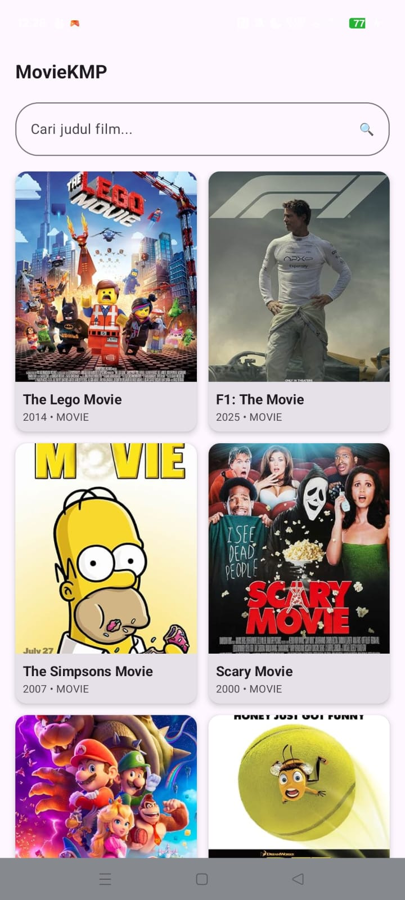 | 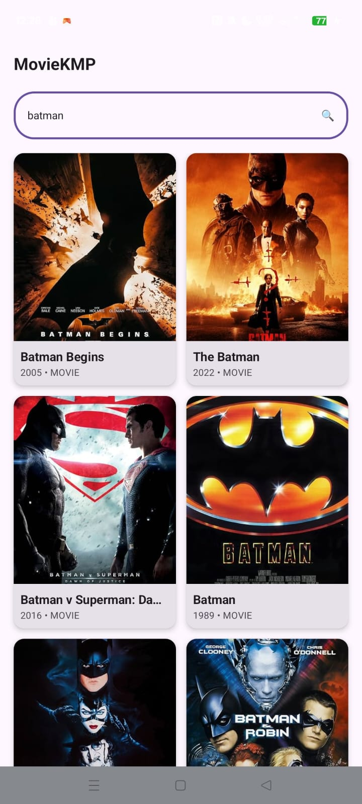 | 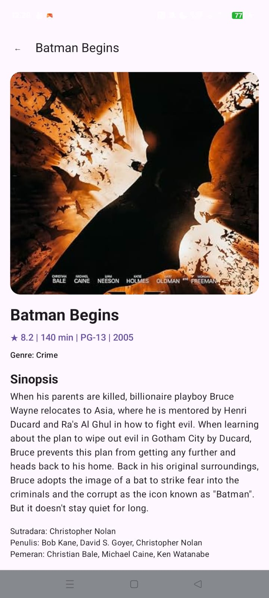 |

---

### 🖥️ Desktop (`desktopApp`)
| List Movies | Search Movies | Detail Movie |
| :---: | :---: | :---: |
| 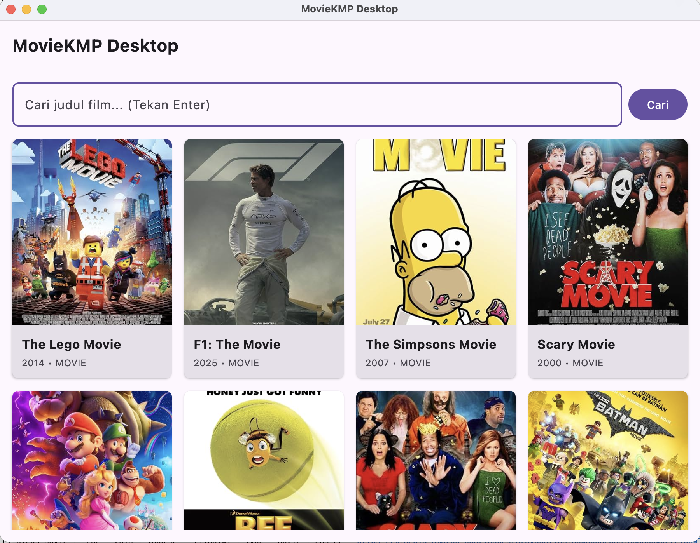 | 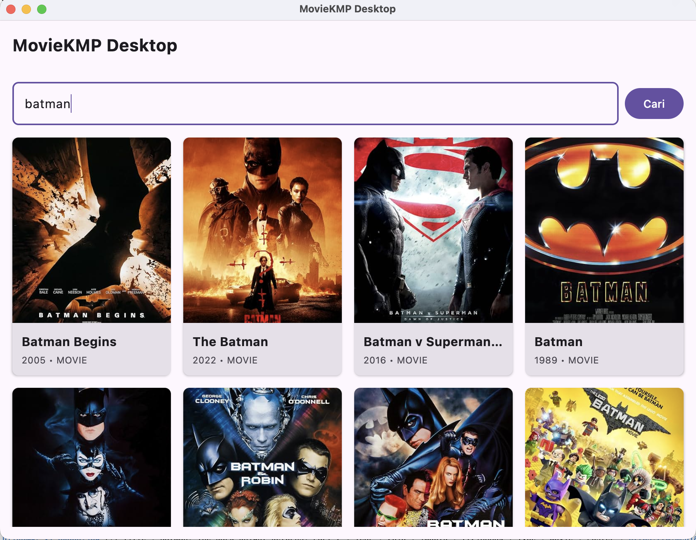 | 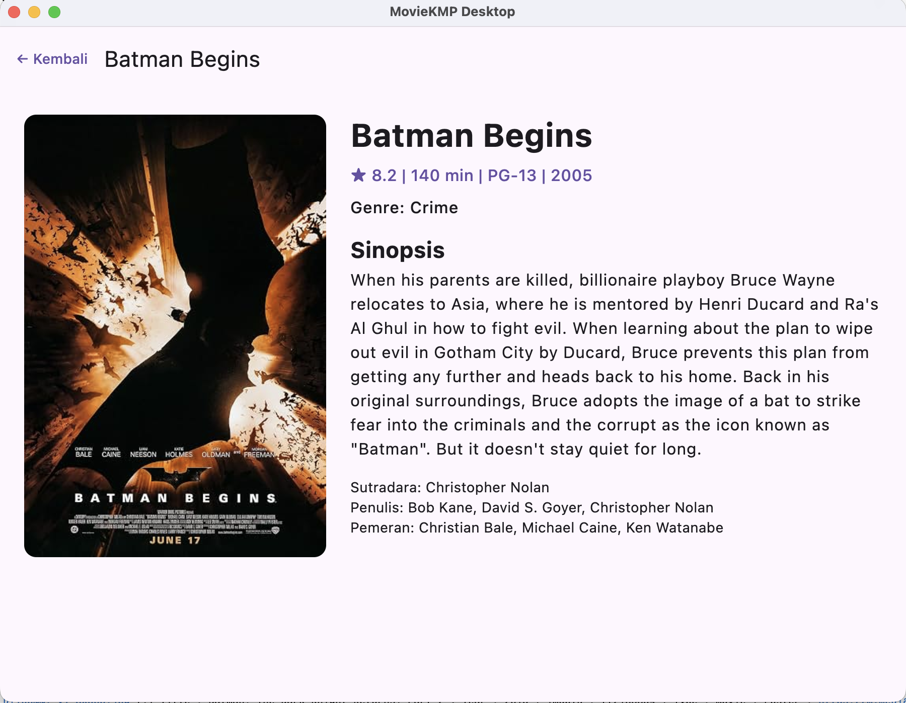 |

---

### 🍎 iOS (`iosApp`)
| List Movies | Search Movies | Detail Movie |
| :---: | :---: | :---: |
| 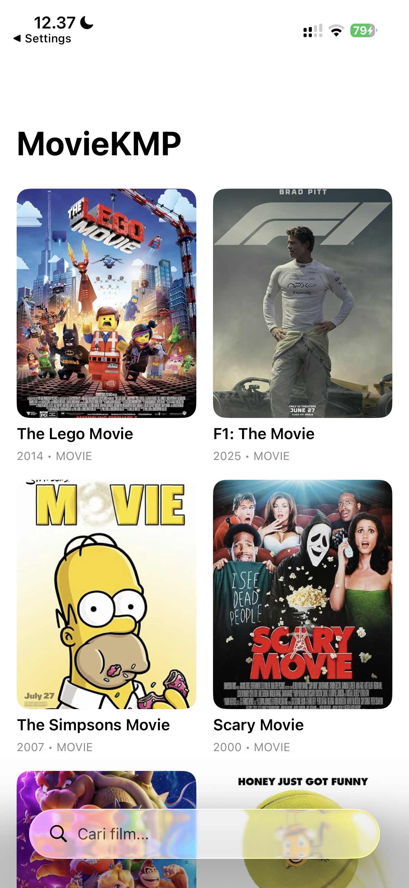 | 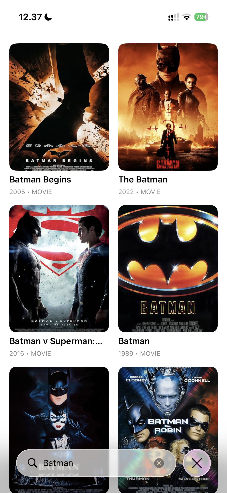 | 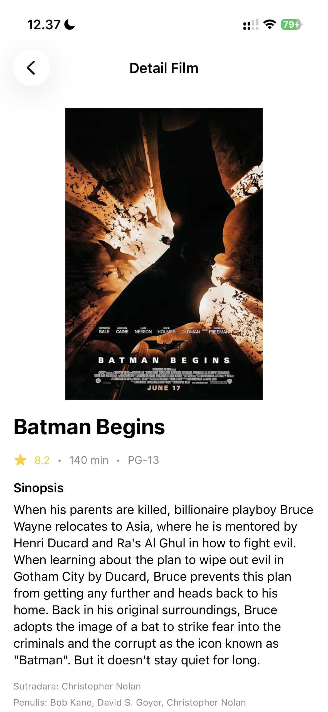 |

---

### 🌐 Web (`webApp`)
| List Movies | Search Movies | Detail Movie |
| :---: | :---: | :---: |
| 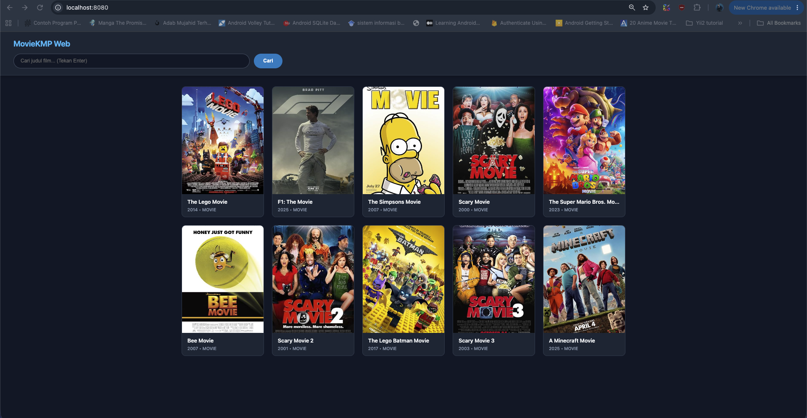 | 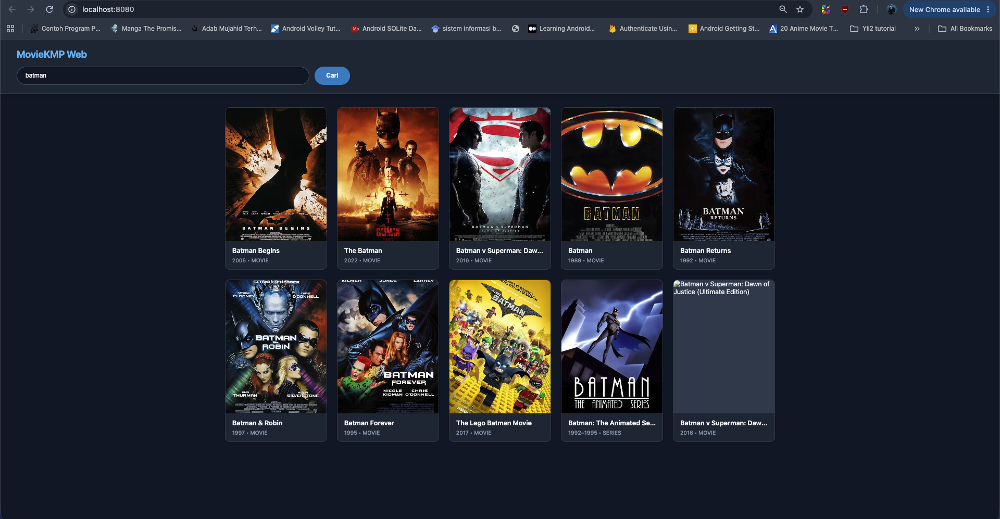 | 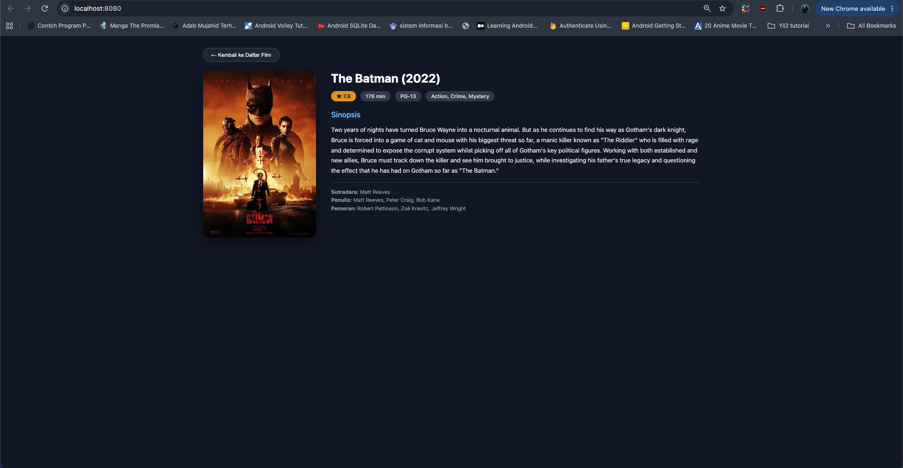 |

---

## 🧪 Unit Testing

Untuk menjalankan seluruh pengujian unit test KMP pada modul `sharedLogic`:
```bash
./gradlew :sharedLogic:allTests
```
