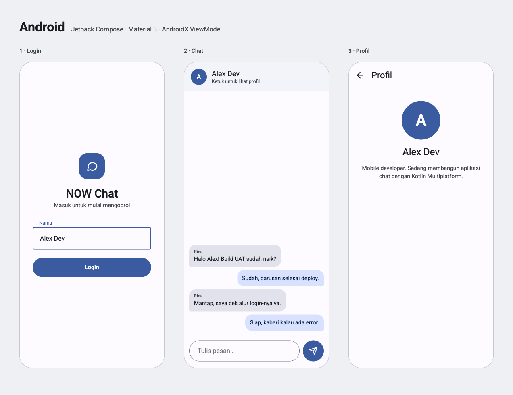

#  androidApp — Presentation Layer (Jetpack Compose + AndroidX ViewModel + Koin)

Rencana implementasi **UI + ViewModel + DI** untuk aplikasi Chat di **Android**. Modul `shared` (model, `ChatRepositoryImpl` in-memory, 4 UseCase, `sharedModule`) **sudah tersedia** — lihat [`docs/feature/shared/shared-kmp.md`](../shared/shared-kmp.md).

| Layer | Teknologi |
|---|---|
| UI | Jetpack Compose + Material 3 |
| State holder | AndroidX `ViewModel` + `StateFlow<UiState>` |
| DI | Koin (`viewModelOf`, `koinViewModel()`) |
| Navigasi | Navigation Compose (type-safe, route `@Serializable`) |

---

## Desain UI (Redesign)



> Desain ini adalah **acuan redesign**. Kode UI di Bagian 6 masih versi sebelumnya; saat redesign, ikuti spesifikasi di bawah. ViewModel, DI, dan navigasi **tidak berubah**.

### Token desain

| Token | Nilai | Pemakaian |
|---|---|---|
| Primary | biru indigo (±`#3A5BA0`) | logo, tombol Login, avatar, tombol kirim, border field aktif |
| Bubble saya | `primaryContainer` (biru muda) | pesan `isMine = true`, rata kanan |
| Bubble lawan | `surfaceVariant` (abu-abu) | pesan lawan, rata kiri, nama pengirim kecil di dalam bubble |
| Background | putih keunguan (Material 3 default `surface`) | semua layar |
| Nama app | **NOW Chat** | judul login |

### 1 · Login
- Logo: kotak rounded (±64dp, radius 16dp) warna primary dengan ikon gelembung chat putih.
- Judul **"NOW Chat"** (headlineMedium, bold) + subjudul "Masuk untuk mulai mengobrol".
- `OutlinedTextField` label **"Nama"**, lebar penuh (padding horizontal ±32dp).
- Tombol **Login** lebar penuh, bentuk pill (`RoundedCornerShape(50)`), warna primary.
- Konten vertikal di tengah layar.

### 2 · Chat
- Top bar: avatar inisial (lingkaran primary) + nama user, dengan subjudul kecil **"Ketuk untuk lihat profil"**. Seluruh area judul bisa diklik → Profil. Background top bar `surfaceContainer` (abu terang).
- Daftar pesan menempel ke bawah (pesan terbaru di bawah).
- Bubble radius ±16dp, lebar maks ±75% layar; nama pengirim (labelSmall) di dalam bubble lawan.
- Bottom bar: `OutlinedTextField` bentuk pill dengan placeholder **"Tulis pesan…"** + tombol kirim **bulat terisi primary** dengan ikon pesawat kertas (`Icons.AutoMirrored.Filled.Send`).

### 3 · Profil
- Top app bar: ikon panah kembali (`Icons.AutoMirrored.Filled.ArrowBack`) + judul **"Profil"**.
- Avatar inisial besar (±96dp) di tengah, nama (headlineSmall), bio rata tengah (bodyMedium).

### Perubahan dari rancangan/implementasi sebelumnya
- [ ] Tambah logo + judul "NOW Chat" + subjudul di Login; tombol Login jadi pill lebar penuh.
- [ ] Top bar Chat: tambah subjudul "Ketuk untuk lihat profil".
- [ ] Input chat jadi pill; tombol kirim jadi `FilledIconButton` bulat (bukan `IconButton` polos).
- [ ] **Avatar selalu inisial** sesuai desain. Catatan: `shared` mengisi `avatarUrl` (pravatar). Jika tetap ingin foto, pakai inisial sebagai fallback/placeholder Coil.
- [ ] Ikon: Android bisa memakai `androidx.compose.material:material-icons-core` (Google) — tambahkan ke catalog.
- [ ] Data contoh di desain (Rina, "Build UAT…") hanya ilustrasi; data nyata berasal dari `ChatRepositoryImpl` di `shared`.

---

## 1. Prinsip

1. **Satu ViewModel per layar:** `LoginViewModel`, `ChatViewModel`, `ProfileViewModel`.
2. **State tunggal immutable** (`UiState`). Composable hanya membaca state dan memanggil fungsi ViewModel.
3. **Navigasi diputuskan oleh UI.** ViewModel hanya menandai hasil (misalnya `loggedInUserId`).
4. **Logika bisnis tetap di `shared`.** Validasi username ada di `LoginUseCase`; ViewModel cukup menampilkan `e.message`.
5. **`userId` dibawa lewat route.** `GetProfileUseCase` mewajibkan `userId`, diambil dari `UserProfile.id` hasil login.
6. **Stream chat** dikoleksi di `viewModelScope` dan otomatis dibatalkan di `onCleared()`.

---

## 2. Dependency (`androidApp/build.gradle.kts`)

UI dan ViewModel diterapkan **langsung di `androidApp`**; module `composeUI` diabaikan dulu. Karena itu `androidApp` bergantung langsung ke `:shared` dan memasang dependency Compose sendiri (sebelumnya didapat lewat `:composeUI`). `koin-android` sudah terpasang untuk `MainApplication`.

```kotlin
plugins {
    alias(libs.plugins.androidApplication)      // AGP 9: Kotlin Android sudah built-in
    alias(libs.plugins.composeCompiler)
    alias(libs.plugins.kotlinSerialization)     // untuk route @Serializable (tambahkan ke catalog)
}

dependencies {
    implementation(project(":shared"))          // langsung, tidak lewat :composeUI

    // Compose (sebelumnya transitif dari :composeUI)
    implementation(libs.compose.runtime)
    implementation(libs.compose.foundation)
    implementation(libs.compose.ui)

    implementation(libs.androidx.activity.compose)
    implementation(libs.compose.material3)
    implementation(libs.compose.materialIconsExtended)          // tambahkan ke catalog

    implementation(libs.androidx.lifecycle.viewmodelCompose)    // sudah ada di catalog
    implementation(libs.androidx.lifecycle.runtimeCompose)      // collectAsStateWithLifecycle
    implementation(libs.androidx.navigation.compose)            // tambahkan ke catalog

    implementation(libs.koin.android)                           // sudah ada
    implementation(libs.koin.androidx.compose)                  // koinViewModel() — tambahkan ke catalog

    implementation(libs.coil.compose)                           // avatar dari URL (opsional)
}
```

> Koin di project ini `4.0.0`; `minSdk` app = 24, sudah memenuhi syarat Koin 4.x.

---

## 3. ViewModel

Semua file di `androidApp/src/main/kotlin/me/poc/kmpchat/`. Import use case dan model dari `me.poc.kmpchat.chat.application.*`.

### 3.1 `LoginViewModel`

```kotlin
// login/LoginViewModel.kt
data class LoginUiState(
    val name: String = "",
    val isLoading: Boolean = false,
    val error: String? = null,
    val loggedInUserId: String? = null,
)

class LoginViewModel(private val loginUseCase: LoginUseCase) : ViewModel() {

    private val _state = MutableStateFlow(LoginUiState())
    val state: StateFlow<LoginUiState> = _state.asStateFlow()

    fun onNameChange(value: String) = _state.update { it.copy(name = value, error = null) }

    fun login() {
        if (_state.value.isLoading) return
        viewModelScope.launch {
            _state.update { it.copy(isLoading = true, error = null) }
            // Validasi (username kosong) dilakukan oleh LoginUseCase di shared
            runCatching { loginUseCase(_state.value.name.trim()) }
                .onSuccess { profile -> _state.update { it.copy(isLoading = false, loggedInUserId = profile.id) } }
                .onFailure { e -> _state.update { it.copy(isLoading = false, error = e.message) } }
        }
    }
}
```

### 3.2 `ChatViewModel`

```kotlin
// chat/ChatViewModel.kt
data class ChatUiState(
    val user: UserProfile? = null,
    val messages: List<ChatMessage> = emptyList(),
    val input: String = "",
    val isSending: Boolean = false,
    val error: String? = null,
)

class ChatViewModel(
    private val userId: String,
    private val getProfileUseCase: GetProfileUseCase,
    observeChatMessagesUseCase: ObserveChatMessagesUseCase,
    private val sendMessageUseCase: SendMessageUseCase,
) : ViewModel() {

    private val _state = MutableStateFlow(ChatUiState())
    val state: StateFlow<ChatUiState> = _state.asStateFlow()

    init {
        viewModelScope.launch {
            runCatching { getProfileUseCase(userId) }
                .onSuccess { user -> _state.update { it.copy(user = user) } }
                .onFailure { e -> _state.update { it.copy(error = e.message) } }
        }

        observeChatMessagesUseCase()
            .onEach { msgs -> _state.update { it.copy(messages = msgs) } }
            .catch { e -> _state.update { it.copy(error = e.message) } }
            .launchIn(viewModelScope)
    }

    fun onInputChange(value: String) = _state.update { it.copy(input = value) }

    fun send() {
        val text = _state.value.input.trim()
        if (text.isEmpty() || _state.value.isSending) return
        viewModelScope.launch {
            _state.update { it.copy(isSending = true) }
            runCatching { sendMessageUseCase(text) }
                .onSuccess { _state.update { it.copy(input = "", isSending = false) } }
                .onFailure { e -> _state.update { it.copy(isSending = false, error = e.message) } }
        }
    }
}
```

### 3.3 `ProfileViewModel`

```kotlin
// profile/ProfileViewModel.kt
data class ProfileUiState(
    val isLoading: Boolean = true,
    val user: UserProfile? = null,
    val error: String? = null,
)

class ProfileViewModel(
    userId: String,
    getProfileUseCase: GetProfileUseCase,
) : ViewModel() {

    private val _state = MutableStateFlow(ProfileUiState())
    val state: StateFlow<ProfileUiState> = _state.asStateFlow()

    init {
        viewModelScope.launch {
            _state.value = runCatching { getProfileUseCase(userId) }.fold(
                onSuccess = { ProfileUiState(isLoading = false, user = it) },
                onFailure = { ProfileUiState(isLoading = false, error = it.message) },
            )
        }
    }
}
```

---

## 4. DI (Koin)

`userId` dikirim sebagai parameter Koin (`parametersOf`), sisanya di-resolve dari `sharedModule`.

```kotlin
// di/AndroidModule.kt
val androidViewModelModule = module {
    viewModelOf(::LoginViewModel)
    viewModel { (userId: String) -> ChatViewModel(userId, get(), get(), get()) }
    viewModel { (userId: String) -> ProfileViewModel(userId, get()) }
}
```

`MainApplication` sudah ada; cukup tambahkan module ViewModel:

```kotlin
// MainApplication.kt
class MainApplication : Application() {
    override fun onCreate() {
        super.onCreate()
        startKoin {
            androidContext(this@MainApplication)
            modules(sharedModule + androidViewModelModule)
        }
    }
}
```

> `MainApplication` sudah terdaftar di `AndroidManifest.xml` (`android:name=".MainApplication"`).

---

## 5. Navigasi

```kotlin
// nav/AppNavigation.kt
@Serializable data object LoginRoute
@Serializable data class ChatRoute(val userId: String)
@Serializable data class ProfileRoute(val userId: String)

@Composable
fun AppNavigation() {
    val nav = rememberNavController()

    NavHost(navController = nav, startDestination = LoginRoute) {
        composable<LoginRoute> {
            LoginScreen(onLoggedIn = { userId ->
                nav.navigate(ChatRoute(userId)) { popUpTo(LoginRoute) { inclusive = true } }
            })
        }
        composable<ChatRoute> { entry ->
            val route = entry.toRoute<ChatRoute>()
            ChatScreen(
                userId = route.userId,
                onAvatarClick = { nav.navigate(ProfileRoute(route.userId)) },
            )
        }
        composable<ProfileRoute> { entry ->
            ProfileScreen(userId = entry.toRoute<ProfileRoute>().userId, onBack = { nav.popBackStack() })
        }
    }
}
```

```kotlin
// MainActivity.kt
class MainActivity : ComponentActivity() {
    override fun onCreate(savedInstanceState: Bundle?) {
        enableEdgeToEdge()
        super.onCreate(savedInstanceState)
        setContent { MaterialTheme { AppNavigation() } }   // menggantikan App() dari composeUI
    }
}
```

> Dengan Navigation Compose, `koinViewModel()` otomatis di-scope ke **back stack entry**. `ChatViewModel` tetap hidup saat Profile dibuka, dan `ProfileViewModel` dibuang saat kembali.

---

## 6. UI

### 6.1 `LoginScreen`

```kotlin
@Composable
fun LoginScreen(onLoggedIn: (userId: String) -> Unit, vm: LoginViewModel = koinViewModel()) {
    val state by vm.state.collectAsStateWithLifecycle()

    LaunchedEffect(state.loggedInUserId) { state.loggedInUserId?.let(onLoggedIn) }

    Column(
        Modifier.fillMaxSize().padding(24.dp),
        verticalArrangement = Arrangement.Center,
        horizontalAlignment = Alignment.CenterHorizontally,
    ) {
        OutlinedTextField(
            value = state.name,
            onValueChange = vm::onNameChange,
            label = { Text("Nama") },
            singleLine = true,
            isError = state.error != null,
        )
        state.error?.let { Text(it, color = MaterialTheme.colorScheme.error) }   // mis. "Username tidak boleh kosong"
        Spacer(Modifier.height(16.dp))
        Button(onClick = vm::login, enabled = !state.isLoading) {
            if (state.isLoading) CircularProgressIndicator(Modifier.size(16.dp), strokeWidth = 2.dp)
            else Text("Login")
        }
    }
}
```

### 6.2 `ChatScreen`

```kotlin
@OptIn(ExperimentalMaterial3Api::class)
@Composable
fun ChatScreen(
    userId: String,
    onAvatarClick: () -> Unit,
    vm: ChatViewModel = koinViewModel { parametersOf(userId) },
) {
    val state by vm.state.collectAsStateWithLifecycle()

    Scaffold(
        topBar = {
            TopAppBar(title = {
                Row(
                    Modifier.clickable(onClick = onAvatarClick),
                    verticalAlignment = Alignment.CenterVertically,
                ) {
                    Avatar(state.user, size = 36.dp)
                    Spacer(Modifier.width(8.dp))
                    Text(state.user?.name.orEmpty())
                }
            })
        },
        bottomBar = {
            Row(
                Modifier.fillMaxWidth().padding(8.dp).imePadding(),
                verticalAlignment = Alignment.CenterVertically,
            ) {
                OutlinedTextField(
                    value = state.input,
                    onValueChange = vm::onInputChange,
                    modifier = Modifier.weight(1f),
                    placeholder = { Text("Tulis pesan…") },
                )
                IconButton(onClick = vm::send, enabled = state.input.isNotBlank() && !state.isSending) {
                    Icon(Icons.AutoMirrored.Filled.Send, contentDescription = "Kirim")
                }
            }
        },
    ) { padding ->
        LazyColumn(
            modifier = Modifier.padding(padding).fillMaxSize(),
            reverseLayout = true,   // pesan terbaru di bawah
        ) {
            items(state.messages.asReversed(), key = { it.id }) { MessageBubble(it) }
        }
    }
}

@Composable
fun MessageBubble(message: ChatMessage) {
    val align = if (message.isMine) Alignment.CenterEnd else Alignment.CenterStart
    Box(Modifier.fillMaxWidth().padding(horizontal = 12.dp, vertical = 4.dp), contentAlignment = align) {
        Surface(
            shape = RoundedCornerShape(12.dp),
            color = if (message.isMine) MaterialTheme.colorScheme.primaryContainer
                    else MaterialTheme.colorScheme.surfaceVariant,
        ) {
            Column(Modifier.padding(10.dp)) {
                if (!message.isMine) Text(message.senderName, style = MaterialTheme.typography.labelSmall)
                Text(message.message)
            }
        }
    }
}
```

### 6.3 `ProfileScreen`

```kotlin
@OptIn(ExperimentalMaterial3Api::class)
@Composable
fun ProfileScreen(
    userId: String,
    onBack: () -> Unit,
    vm: ProfileViewModel = koinViewModel { parametersOf(userId) },
) {
    val state by vm.state.collectAsStateWithLifecycle()

    Scaffold(topBar = {
        TopAppBar(
            title = { Text("Profil") },
            navigationIcon = {
                IconButton(onClick = onBack) { Icon(Icons.AutoMirrored.Filled.ArrowBack, "Kembali") }
            },
        )
    }) { padding ->
        Column(
            Modifier.padding(padding).fillMaxSize().padding(24.dp),
            horizontalAlignment = Alignment.CenterHorizontally,
        ) {
            val user = state.user
            when {
                state.isLoading -> CircularProgressIndicator()
                user == null -> Text(state.error ?: "Profil tidak ditemukan")
                else -> {
                    Avatar(user, size = 96.dp)
                    Spacer(Modifier.height(16.dp))
                    Text(user.name, style = MaterialTheme.typography.headlineSmall)
                    Spacer(Modifier.height(8.dp))
                    Text(user.bio, style = MaterialTheme.typography.bodyMedium)
                }
            }
        }
    }
}
```

### 6.4 Komponen `Avatar`

`UserProfile.avatarUrl` bertipe `String` non-null, jadi cek string kosong:

```kotlin
@Composable
fun Avatar(user: UserProfile?, size: Dp) {
    val url = user?.avatarUrl.orEmpty()
    if (url.isNotBlank()) {
        AsyncImage(
            model = url,
            contentDescription = user?.name,
            modifier = Modifier.size(size).clip(CircleShape),
            contentScale = ContentScale.Crop,
        )
    } else {
        Box(
            Modifier.size(size).clip(CircleShape).background(MaterialTheme.colorScheme.primary),
            contentAlignment = Alignment.Center,
        ) {
            Text(
                text = user?.name?.firstOrNull()?.uppercase() ?: "?",
                color = MaterialTheme.colorScheme.onPrimary,
            )
        }
    }
}
```

---

## 7. Testing

- **ViewModel:** `kotlinx-coroutines-test` + `Dispatchers.setMain(StandardTestDispatcher())`. Uji transisi `UiState`: error dari use case saat nama kosong, loading → `loggedInUserId` terisi, input dikosongkan setelah kirim.
- **Fake UseCase:** use case adalah `fun interface`, jadi stub cukup lambda, misalnya `LoginUseCase { name -> UserProfile("u1", name, "", "") }`. `UseCaseImpl` bersifat `internal` di `shared` sehingga tidak bisa dibuat langsung dari `androidApp`.
- **UI (opsional):** `androidx.compose.ui:ui-test-junit4` untuk alur Login → Chat → Profile.

---

## 8. Struktur File

```
androidApp/src/main/kotlin/me/poc/kmpchat/
├── MainApplication.kt          # startKoin { androidContext; modules(sharedModule + androidViewModelModule) }
├── MainActivity.kt             # setContent { AppNavigation() }
├── di/AndroidModule.kt         # LoginViewModel + Chat/Profile dengan parametersOf(userId)
├── nav/AppNavigation.kt        # LoginRoute, ChatRoute(userId), ProfileRoute(userId)
├── ui/Avatar.kt
├── login/
│   ├── LoginViewModel.kt
│   └── LoginScreen.kt
├── chat/
│   ├── ChatViewModel.kt
│   └── ChatScreen.kt           # + MessageBubble
└── profile/
    ├── ProfileViewModel.kt
    └── ProfileScreen.kt
```

> Catatan modul: `composeUI` **diabaikan dulu** untuk penerapan ini. Semua layar & ViewModel Android ada di `androidApp`. Setelah `MainActivity` memakai `AppNavigation()`, dependency `implementation(project(":composeUI"))` di `androidApp/build.gradle.kts` bisa dilepas.
