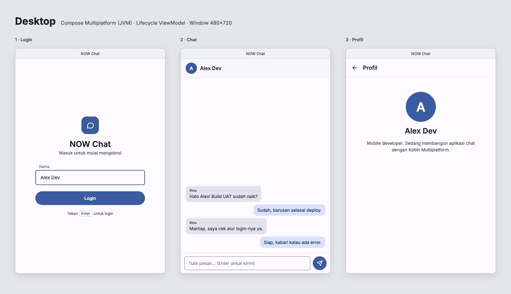

#  desktopApp — Presentation Layer (Compose Multiplatform JVM + Lifecycle ViewModel + Koin)

Rencana implementasi **UI + ViewModel + DI** untuk aplikasi Chat di **Desktop (JVM)**. Modul `shared` (model, `ChatRepositoryImpl` in-memory, 4 UseCase, `sharedModule`) **sudah tersedia** — lihat [`docs/feature/shared/shared-kmp.md`](../shared/shared-kmp.md).

| Layer | Teknologi |
|---|---|
| UI | Compose Multiplatform Desktop + Material 3 |
| State holder | JetBrains Lifecycle `ViewModel` + `StateFlow<UiState>` |
| DI | Koin (`viewModelOf`, `koinViewModel()`) |
| Navigasi | State-based (`sealed interface DesktopRoute`) |

Setup dependency ViewModel desktop (versi, alasan tiap library) ada di [`docs/libs/platform/desktopApp-viewmodel.md`](../../libs/platform/desktopApp-viewmodel.md). Ringkasannya ada di Bagian 2.

---

## Desain UI (Redesign)



> Desain ini adalah **acuan redesign** dan **sudah diterapkan** di `desktopApp`. Contoh kode UI di Bagian 6 masih versi sebelum redesign; implementasi di repo adalah acuannya. ViewModel, DI, dan navigasi **tidak berubah**.
>
> File redesign di `desktopApp/src/main/kotlin/me/poc/kmpchat/`:
> - `ui/Theme.kt` — `NowChatTheme` (color scheme sesuai token di bawah)
> - `ui/Icons.kt` — `NowIcons.ChatBubble`, `Send`, `ArrowBack` (`ImageVector` garis, path diadaptasi dari Lucide, ISC License)
> - `ui/NowTextField.kt` — field custom: label di luar border, tinggi bisa diatur (`OutlinedTextField` M3 minimal 56dp)
> - `ui/Avatar.kt`, `login/LoginScreen.kt`, `chat/ChatScreen.kt`, `profile/ProfileScreen.kt`, `main.kt` (`title = "NOW Chat"`)

### Token desain

| Token | Nilai | Pemakaian |
|---|---|---|
| Primary | biru indigo (±`#3A5BA0`) | logo, tombol Login, avatar, tombol kirim, border field aktif |
| Bubble saya | `primaryContainer` (biru muda) | pesan `isMine = true`, rata kanan |
| Bubble lawan | `surfaceVariant` (abu-abu) | pesan lawan, rata kiri, nama pengirim kecil di dalam bubble |
| Window | 480×720, judul **"NOW Chat"** | `Window(title = "NOW Chat")` |

### 1 · Login
- Logo kotak rounded primary dengan ikon gelembung chat, judul **"NOW Chat"** (bold) + subjudul "Masuk untuk mulai mengobrol".
- `OutlinedTextField` label **"Nama"**, tombol **Login** pill lebar penuh (lebar sama dengan field).
- Hint keyboard di bawah tombol: **"Tekan `Enter` untuk login"** (kata *Enter* dalam kotak kecil bergaya tombol keyboard).

### 2 · Chat
- Top bar: avatar inisial + nama user **bold** (tanpa subjudul), background abu terang, garis pemisah bawah. Klik → Profil (kursor tangan).
- Bubble radius ±12dp, nama pengirim (labelSmall) di dalam bubble lawan; teks bisa diseleksi.
- Bottom bar: `OutlinedTextField` persegi rounded kecil dengan placeholder **"Tulis pesan… (Enter untuk kirim)"** + tombol kirim **bulat terisi primary** dengan ikon pesawat kertas. Garis pemisah di atas bottom bar.

### 3 · Profil
- Top bar: ikon panah kembali + judul **"Profil"** (bold), garis pemisah bawah.
- Avatar inisial besar (±96dp), nama (bold, besar), bio rata tengah.

### Perubahan dari implementasi saat ini
- [x] `Window(title = "KMPChat")` → **"NOW Chat"**.
- [x] Login: tambah logo, judul, subjudul, hint "Tekan Enter untuk login"; tombol jadi pill lebar penuh.
- [x] Chat: tombol **"Kirim" (TextButton) → tombol ikon bulat** terisi primary.
- [x] Profil: **"← Kembali" (TextButton) → ikon panah kembali**.
- [x] **Ikon:** library `material-icons` tidak lagi dirilis bersama CMP ≥ 1.8. Pilihan: (a) `ImageVector` buatan sendiri di `ui/Icons.kt` untuk Send, ArrowBack, dan Chat bubble (direkomendasikan, tanpa dependency), atau (b) `org.jetbrains.compose.material:material-icons-core:1.7.3` (versi lama, perlu dicek kompatibilitasnya).
- [ ] Data contoh di desain (Rina, "Build UAT…") hanya ilustrasi; data nyata berasal dari `ChatRepositoryImpl` di `shared`.

---

## 1. Prinsip

1. **Satu ViewModel per layar:** `LoginViewModel`, `ChatViewModel`, `ProfileViewModel`.
2. **State tunggal immutable** (`UiState`). Composable hanya membaca state dan memanggil fungsi ViewModel.
3. **Navigasi diputuskan oleh UI** (`main.kt`), bukan oleh ViewModel.
4. **Logika bisnis tetap di `shared`.** Validasi username ada di `LoginUseCase`; ViewModel cukup menampilkan `e.message`.
5. **`userId` dibawa lewat route** (`DesktopRoute.Chat(userId)`), karena `GetProfileUseCase` mewajibkan `userId`.
6. **ViewModel di-scope ke `Window`** karena navigasi berbasis state, sehingga stream chat tidak restart saat bolak-balik ke Profile.

> Kode ViewModel di sini **identik dengan `androidApp`**. Duplikasi ini disengaja: `shared` tidak berisi ViewModel, dan UI diterapkan **langsung di masing-masing platform** (`androidApp` dan `desktopApp`). Module `composeUI` diabaikan dulu.

---

## 2. Dependency (`desktopApp/build.gradle.kts`)

`desktopApp` adalah module **Kotlin/JVM** (bukan KMP). UI dan ViewModel diterapkan **langsung di `desktopApp`**; module `composeUI` diabaikan dulu, sehingga `desktopApp` bergantung langsung ke `:shared` (artefak JVM-nya dipilih otomatis). `koin-core` sudah ditambahkan untuk `startKoin`.

```kotlin
import org.jetbrains.compose.desktop.application.dsl.TargetFormat

plugins {
    alias(libs.plugins.kotlinJvm)
    alias(libs.plugins.composeMultiplatform)
    alias(libs.plugins.composeCompiler)
}

dependencies {
    implementation(project(":shared"))                        // langsung, tidak lewat :composeUI

    implementation(compose.desktop.currentOs)
    implementation(libs.compose.material3)
    implementation(libs.compose.uiToolingPreview)
    // Tidak memakai material-icons: artifact-nya berhenti dirilis bersama CMP sejak 1.8,
    // jadi tombol Kirim/Kembali memakai TextButton.

    // ViewModel CMP (JetBrains) — alias sudah ada di catalog
    implementation(libs.androidx.lifecycle.viewmodelCompose)
    implementation(libs.androidx.lifecycle.runtimeCompose)

    // Koin
    implementation(libs.koin.core)                            // sudah ada
    implementation(libs.koin.compose)                         // sudah ada
    implementation(libs.koin.compose.viewmodel)               // koinViewModel() — sudah ada

    // Wajib: Dispatchers.Main (Swing) untuk viewModelScope — sudah ada
    implementation(libs.kotlinx.coroutinesSwing)

    testImplementation(libs.kotlin.test)
    testImplementation(libs.kotlinx.coroutines.test)
}

compose.desktop {
    application {
        mainClass = "me.poc.kmpchat.MainKt"
        nativeDistributions {
            targetFormats(TargetFormat.Dmg, TargetFormat.Msi, TargetFormat.Deb)
            packageName = "me.poc.kmpchat"
            packageVersion = "1.0.0"
        }
    }
}
```

---

## 3. ViewModel

Semua file di `desktopApp/src/main/kotlin/me/poc/kmpchat/`. Import `androidx.lifecycle.ViewModel` / `viewModelScope` berasal dari artifact JetBrains; use case & model dari `me.poc.kmpchat.chat.application.*`.

### 3.1 `LoginViewModel`

```kotlin
// login/LoginViewModel.kt
data class LoginUiState(
    val name: String = "",
    val isLoading: Boolean = false,
    val error: String? = null,
    val loggedInUserId: String? = null,
)

class LoginViewModel(private val loginUseCase: LoginUseCase) : ViewModel() {

    private val _state = MutableStateFlow(LoginUiState())
    val state: StateFlow<LoginUiState> = _state.asStateFlow()

    fun onNameChange(value: String) = _state.update { it.copy(name = value, error = null) }

    fun login() {
        if (_state.value.isLoading) return
        viewModelScope.launch {
            _state.update { it.copy(isLoading = true, error = null) }
            // Validasi (username kosong) dilakukan oleh LoginUseCase di shared
            runCatching { loginUseCase(_state.value.name.trim()) }
                .onSuccess { profile -> _state.update { it.copy(isLoading = false, loggedInUserId = profile.id) } }
                .onFailure { e -> _state.update { it.copy(isLoading = false, error = e.message) } }
        }
    }
}
```

### 3.2 `ChatViewModel`

```kotlin
// chat/ChatViewModel.kt
data class ChatUiState(
    val user: UserProfile? = null,
    val messages: List<ChatMessage> = emptyList(),
    val input: String = "",
    val isSending: Boolean = false,
    val error: String? = null,
)

class ChatViewModel(
    private val userId: String,
    private val getProfileUseCase: GetProfileUseCase,
    observeChatMessagesUseCase: ObserveChatMessagesUseCase,
    private val sendMessageUseCase: SendMessageUseCase,
) : ViewModel() {

    private val _state = MutableStateFlow(ChatUiState())
    val state: StateFlow<ChatUiState> = _state.asStateFlow()

    init {
        viewModelScope.launch {
            runCatching { getProfileUseCase(userId) }
                .onSuccess { user -> _state.update { it.copy(user = user) } }
                .onFailure { e -> _state.update { it.copy(error = e.message) } }
        }

        observeChatMessagesUseCase()
            .onEach { msgs -> _state.update { it.copy(messages = msgs) } }
            .catch { e -> _state.update { it.copy(error = e.message) } }
            .launchIn(viewModelScope)
    }

    fun onInputChange(value: String) = _state.update { it.copy(input = value) }

    fun send() {
        val text = _state.value.input.trim()
        if (text.isEmpty() || _state.value.isSending) return
        viewModelScope.launch {
            _state.update { it.copy(isSending = true) }
            runCatching { sendMessageUseCase(text) }
                .onSuccess { _state.update { it.copy(input = "", isSending = false) } }
                .onFailure { e -> _state.update { it.copy(isSending = false, error = e.message) } }
        }
    }
}
```

### 3.3 `ProfileViewModel`

Karena di-scope ke Window, `ProfileViewModel` tidak dibuat ulang saat layar dibuka kembali. Sediakan `refresh(userId)` agar data selalu segar:

```kotlin
// profile/ProfileViewModel.kt
data class ProfileUiState(
    val isLoading: Boolean = true,
    val user: UserProfile? = null,
    val error: String? = null,
)

class ProfileViewModel(private val getProfileUseCase: GetProfileUseCase) : ViewModel() {

    private val _state = MutableStateFlow(ProfileUiState())
    val state: StateFlow<ProfileUiState> = _state.asStateFlow()

    fun refresh(userId: String) {
        viewModelScope.launch {
            _state.update { it.copy(isLoading = true, error = null) }
            _state.value = runCatching { getProfileUseCase(userId) }.fold(
                onSuccess = { ProfileUiState(isLoading = false, user = it) },
                onFailure = { ProfileUiState(isLoading = false, error = it.message) },
            )
        }
    }
}
```

---

## 4. DI (Koin)

```kotlin
// di/DesktopModule.kt
val desktopViewModelModule = module {
    viewModelOf(::LoginViewModel)
    viewModel { (userId: String) -> ChatViewModel(userId, get(), get(), get()) }
    viewModelOf(::ProfileViewModel)
}
```

---

## 5. Entry Point & Navigasi

`main.kt` saat ini sudah memanggil `startKoin { modules(sharedModule) }` lalu menampilkan `App()` dari `composeUI`. Ganti menjadi (setelah ini `implementation(project(":composeUI"))` bisa dilepas dari `desktopApp/build.gradle.kts`):

```kotlin
// desktopApp/src/main/kotlin/me/poc/kmpchat/main.kt
package me.poc.kmpchat

import androidx.compose.material3.MaterialTheme
import androidx.compose.runtime.*
import androidx.compose.ui.unit.dp
import androidx.compose.ui.window.Window
import androidx.compose.ui.window.application
import androidx.compose.ui.window.rememberWindowState
import me.poc.kmpchat.chat.ChatScreen
import me.poc.kmpchat.core.sharedModule
import me.poc.kmpchat.di.desktopViewModelModule
import me.poc.kmpchat.login.LoginScreen
import me.poc.kmpchat.profile.ProfileScreen
import org.koin.core.context.startKoin

sealed interface DesktopRoute {
    data object Login : DesktopRoute
    data class Chat(val userId: String) : DesktopRoute
    data class Profile(val userId: String) : DesktopRoute
}

fun main() {
    // Start Koin SEKALI sebelum membuka Window
    startKoin { modules(sharedModule + desktopViewModelModule) }

    application {
        Window(
            onCloseRequest = ::exitApplication,
            title = "KMPChat",
            state = rememberWindowState(width = 480.dp, height = 720.dp),
        ) {
            var route by remember { mutableStateOf<DesktopRoute>(DesktopRoute.Login) }

            MaterialTheme {
                when (val r = route) {
                    DesktopRoute.Login -> LoginScreen(onLoggedIn = { id -> route = DesktopRoute.Chat(id) })
                    is DesktopRoute.Chat -> ChatScreen(
                        userId = r.userId,
                        onAvatarClick = { route = DesktopRoute.Profile(r.userId) },
                    )
                    is DesktopRoute.Profile -> ProfileScreen(
                        userId = r.userId,
                        onBack = { route = DesktopRoute.Chat(r.userId) },
                    )
                }
            }
        }
    }
}
```

> CMP Desktop menyediakan `ViewModelStoreOwner` default per `Window`, sehingga `koinViewModel()` langsung bisa dipakai. Jika versi CMP yang dipakai melempar error terkait `ViewModelStoreOwner`, bungkus isi `Window` dengan `ViewModelStoreOwner` manual.

> Karena ViewModel di-scope ke Window, parameter `userId` hanya dipakai saat `ChatViewModel` pertama dibuat. Ini aman selama satu window = satu user. Jika butuh scope per layar atau back stack, ganti navigasi state ini dengan `org.jetbrains.androidx.navigation:navigation-compose`.

---

## 6. UI

### 6.1 `LoginScreen`

```kotlin
// login/LoginScreen.kt
@Composable
fun LoginScreen(onLoggedIn: (userId: String) -> Unit, vm: LoginViewModel = koinViewModel()) {
    val state by vm.state.collectAsStateWithLifecycle()

    LaunchedEffect(state.loggedInUserId) { state.loggedInUserId?.let(onLoggedIn) }

    Column(
        Modifier.fillMaxSize().padding(32.dp),
        verticalArrangement = Arrangement.Center,
        horizontalAlignment = Alignment.CenterHorizontally,
    ) {
        OutlinedTextField(
            value = state.name,
            onValueChange = vm::onNameChange,
            label = { Text("Nama") },
            singleLine = true,
            isError = state.error != null,
            modifier = Modifier.onPreviewKeyEvent { e ->
                // Enter untuk login
                if (e.key == Key.Enter && e.type == KeyEventType.KeyUp) { vm.login(); true } else false
            },
        )
        state.error?.let { Text(it, color = MaterialTheme.colorScheme.error) }   // mis. "Username tidak boleh kosong"
        Spacer(Modifier.height(16.dp))
        Button(onClick = vm::login, enabled = !state.isLoading) {
            if (state.isLoading) CircularProgressIndicator(Modifier.size(16.dp), strokeWidth = 2.dp)
            else Text("Login")
        }
    }
}
```

### 6.2 `ChatScreen`

```kotlin
// chat/ChatScreen.kt
@OptIn(ExperimentalMaterial3Api::class)
@Composable
fun ChatScreen(
    userId: String,
    onAvatarClick: () -> Unit,
    vm: ChatViewModel = koinViewModel { parametersOf(userId) },
) {
    val state by vm.state.collectAsStateWithLifecycle()
    val listState = rememberLazyListState()

    // Auto-scroll ke pesan terbaru
    LaunchedEffect(state.messages.size) {
        if (state.messages.isNotEmpty()) listState.animateScrollToItem(state.messages.lastIndex)
    }

    Scaffold(
        topBar = {
            TopAppBar(title = {
                Row(
                    Modifier.clickable(onClick = onAvatarClick).pointerHoverIcon(PointerIcon.Hand),
                    verticalAlignment = Alignment.CenterVertically,
                ) {
                    Avatar(state.user, size = 36.dp)
                    Spacer(Modifier.width(8.dp))
                    Text(state.user?.name.orEmpty())
                }
            })
        },
        bottomBar = {
            Row(Modifier.fillMaxWidth().padding(8.dp), verticalAlignment = Alignment.CenterVertically) {
                OutlinedTextField(
                    value = state.input,
                    onValueChange = vm::onInputChange,
                    placeholder = { Text("Tulis pesan… (Enter untuk kirim)") },
                    modifier = Modifier.weight(1f).onPreviewKeyEvent { e ->
                        // Enter = kirim, Shift+Enter = baris baru
                        if (e.key == Key.Enter && e.type == KeyEventType.KeyDown && !e.isShiftPressed) {
                            vm.send(); true
                        } else false
                    },
                )
                TextButton(onClick = vm::send, enabled = state.input.isNotBlank() && !state.isSending) {
                    Text("Kirim")
                }
            }
        },
    ) { padding ->
        LazyColumn(state = listState, modifier = Modifier.padding(padding).fillMaxSize()) {
            items(state.messages, key = { it.id }) { MessageBubble(it) }
        }
    }
}

@Composable
fun MessageBubble(message: ChatMessage) {
    val align = if (message.isMine) Alignment.CenterEnd else Alignment.CenterStart
    Box(Modifier.fillMaxWidth().padding(horizontal = 12.dp, vertical = 4.dp), contentAlignment = align) {
        Surface(
            shape = RoundedCornerShape(12.dp),
            color = if (message.isMine) MaterialTheme.colorScheme.primaryContainer
                    else MaterialTheme.colorScheme.surfaceVariant,
        ) {
            Column(Modifier.padding(10.dp).widthIn(max = 320.dp)) {
                if (!message.isMine) Text(message.senderName, style = MaterialTheme.typography.labelSmall)
                SelectionContainer { Text(message.message) }   // teks bisa di-copy di desktop
            }
        }
    }
}
```

### 6.3 `ProfileScreen`

```kotlin
// profile/ProfileScreen.kt
@OptIn(ExperimentalMaterial3Api::class)
@Composable
fun ProfileScreen(userId: String, onBack: () -> Unit, vm: ProfileViewModel = koinViewModel()) {
    val state by vm.state.collectAsStateWithLifecycle()

    LaunchedEffect(userId) { vm.refresh(userId) }   // muat ulang setiap layar dibuka

    Scaffold(topBar = {
        TopAppBar(
            title = { Text("Profil") },
            navigationIcon = { TextButton(onClick = onBack) { Text("← Kembali") } },
        )
    }) { padding ->
        Column(
            Modifier.padding(padding).fillMaxSize().padding(24.dp),
            horizontalAlignment = Alignment.CenterHorizontally,
        ) {
            val user = state.user
            when {
                state.isLoading -> CircularProgressIndicator()
                user == null -> Text(state.error ?: "Profil tidak ditemukan")
                else -> {
                    Avatar(user, size = 96.dp)
                    Spacer(Modifier.height(16.dp))
                    Text(user.name, style = MaterialTheme.typography.headlineSmall)
                    Spacer(Modifier.height(8.dp))
                    Text(user.bio, style = MaterialTheme.typography.bodyMedium)
                }
            }
        }
    }
}
```

### 6.4 Komponen `Avatar`

Untuk tahap awal, tampilkan **inisial** saja. Memuat gambar dari `avatarUrl` di desktop butuh library tambahan, misalnya Coil 3 (multiplatform) dengan network fetcher Ktor.

```kotlin
// ui/Avatar.kt
@Composable
fun Avatar(user: UserProfile?, size: Dp) {
    Box(
        Modifier.size(size).clip(CircleShape).background(MaterialTheme.colorScheme.primary),
        contentAlignment = Alignment.Center,
    ) {
        Text(
            text = user?.name?.firstOrNull()?.uppercase() ?: "?",
            color = MaterialTheme.colorScheme.onPrimary,
        )
    }
}
```

---

## 7. Catatan Desktop

- **Keyboard-first:** Enter untuk login dan kirim pesan, Shift+Enter untuk baris baru.
- **Teks bisa diseleksi** (`SelectionContainer`) agar pesan bisa di-copy.
- **Ukuran window** awal 480×720 menyerupai layout chat. Layout tetap responsif jika window di-resize.
- **Multi-window:** setiap `Window` punya `ViewModelStore` sendiri, tapi `ChatRepositoryImpl` adalah singleton Koin, sehingga daftar pesan sama di semua window.

---

## 8. Testing

- **ViewModel** di `desktopApp/src/test/kotlin/me/poc/kmpchat/DesktopViewModelTest.kt`: Koin asli (`sharedModule + desktopViewModelModule`) + `Dispatchers.setMain(UnconfinedTestDispatcher())`. Skenario: error dari use case saat nama kosong, `loggedInUserId` terisi setelah login, `ChatViewModel` (via `parametersOf(userId)`) memuat profil dan mengosongkan input setelah kirim, dan `refresh(userId)` di Profile. Jalankan dengan `./gradlew :desktopApp:test`.
- **Pakai `runBlocking`, bukan `runTest`**, saat memakai use case asli: use case berpindah ke `Dispatchers.Default` (thread nyata), sedangkan `withTimeout` di `runTest` memakai waktu virtual.
- **Fake UseCase:** stub `fun interface` dengan lambda (`GetProfileUseCase { id -> UserProfile(id, "Alex", "", "") }`). `UseCaseImpl` bersifat `internal` di `shared`.
- **UI (opsional):** `compose.uiTest` (`runComposeUiTest`) untuk alur Login → Chat → Profile.

---

## 9. Struktur File

```
desktopApp/
├── build.gradle.kts                  # kotlinJvm + compose; mainClass = "me.poc.kmpchat.MainKt"
└── src/main/kotlin/me/poc/kmpchat/
    ├── main.kt                       # startKoin(sharedModule + desktopViewModelModule) + Window + DesktopRoute
    ├── di/DesktopModule.kt           # LoginViewModel, ChatViewModel(userId), ProfileViewModel
    ├── ui/Avatar.kt
    ├── login/
    │   ├── LoginViewModel.kt
    │   └── LoginScreen.kt
    ├── chat/
    │   ├── ChatViewModel.kt
    │   └── ChatScreen.kt             # + MessageBubble
    └── profile/
        ├── ProfileViewModel.kt       # refresh(userId)
        └── ProfileScreen.kt
```
