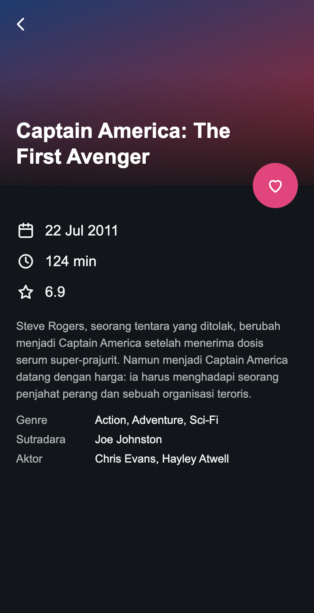

# 📱 androidApp — Presentation Layer Fitur `detailMovies` (Jetpack Compose + AndroidX ViewModel + Koin)

Dokumen ini menjelaskan arsitektur dan spesifikasi implementasi **UI + ViewModel + DI + Navigasi** untuk layar detail film (**`detailMovie`**) pada platform **Android**.

| Layer | Teknologi |
|---|---|
| UI | Jetpack Compose + Material 3 |
| State Holder | AndroidX `ViewModel` + `StateFlow<MovieDetailUiState>` |
| DI | Koin (`viewModel { (imdbId: String) -> MovieDetailViewModel(...) }`) |
| Navigasi | Navigation Compose (`MovieDetailRoute(val imdbId: String)`) |
| Image Loading | Coil Compose (`AsyncImage`) |

---

## Desain UI



> Desain ini adalah **acuan visual UI**:
> - `androidApp-design.png`: Menampilkan halaman detail film lengkap dengan hero poster, rating IMDb, metadata durasi/genre, plot sinopsis, serta daftar aktor & sutradara.

---

## 1. Spesifikasi Komponen UI

1. **TopBar**:
   - Navigation Icon: Panah kembali (`Icons.AutoMirrored.Filled.ArrowBack`).
   - Title: Judul film (mis. *"The Dark Knight"*).
2. **Hero Poster**: Poster film rasio 2:3 dengan sudut rounded `16.dp` dan efek bayangan/gradien.
3. **Rating & Metadata Badges**:
   - Star Icon + IMDb Rating (`★ 9.0/10`).
   - Metascore Badge (mis. `Metascore 84`).
   - Chip informasi: `PG-13` • `152 min` • `2008`.
   - Chip Genre: `Action`, `Crime`, `Drama`.
4. **Detail Sinopsis (`Plot`)**: Teks sinopsis lengkap dengan gaya `MaterialTheme.typography.bodyLarge`.
5. **Info Cast & Crew**:
   - Sutradara (`Director`)
   - Penulis (`Writer`)
   - Aktor Utama (`Actors`)
   - Penghargaan (`Awards`)
   - Pendapatan Box Office (`BoxOffice`)

---

## 2. Dependency (`androidApp/build.gradle.kts`)

```kotlin
dependencies {
    implementation(project(":sharedLogic"))
    implementation(libs.compose.material3)
    implementation(libs.androidx.lifecycle.viewmodelCompose)
    implementation(libs.androidx.navigation.compose)
    implementation(libs.koin.androidx.compose)
    implementation(libs.coil.compose)
}
```

---

## 3. ViewModel (`MovieDetailViewModel.kt`)

```kotlin
package me.test.project.moviekmp.feature.movie.presentation.detail

import androidx.lifecycle.ViewModel
import androidx.lifecycle.viewModelScope
import kotlinx.coroutines.flow.*
import kotlinx.coroutines.launch
import me.test.project.moviekmp.feature.movie.application.model.MovieDetail
import me.test.project.moviekmp.feature.movie.application.usecase.GetDetailMoviesUseCase

data class MovieDetailUiState(
    val isLoading: Boolean = true,
    val movie: MovieDetail? = null,
    val error: String? = null,
)

class MovieDetailViewModel(
    private val imdbId: String,
    private val getDetailMoviesUseCase: GetDetailMoviesUseCase
) : ViewModel() {

    private val _state = MutableStateFlow(MovieDetailUiState())
    val state: StateFlow<MovieDetailUiState> = _state.asStateFlow()

    init {
        loadMovieDetail()
    }

    fun loadMovieDetail() {
        viewModelScope.launch {
            _state.update { it.copy(isLoading = true, error = null) }
            runCatching { getDetailMoviesUseCase(imdbId = imdbId) }
                .onSuccess { detail ->
                    _state.update { it.copy(isLoading = false, movie = detail) }
                }
                .onFailure { e ->
                    _state.update { it.copy(isLoading = false, error = e.message ?: "Gagal memuat detail film") }
                }
        }
    }
}
```

---

## 4. Dependency Injection & Navigasi

### DI (`di/AndroidMovieModule.kt`)
```kotlin
val androidMovieViewModelModule = module {
    viewModel { (imdbId: String) -> MovieDetailViewModel(imdbId, get()) }
}
```

### Navigasi (`nav/AppNavigation.kt`)
```kotlin
@Serializable data class MovieDetailRoute(val imdbId: String)

composable<MovieDetailRoute> { entry ->
    val route = entry.toRoute<MovieDetailRoute>()
    MovieDetailScreen(
        imdbId = route.imdbId,
        onBackClick = { navController.popBackStack() }
    )
}
```

---

## 5. Ringkasan Struktur File

```
androidApp/src/main/kotlin/me/test/project/moviekmp/
└── feature/movie/presentation/detail/
    ├── MovieDetailViewModel.kt
    └── MovieDetailScreen.kt
```
