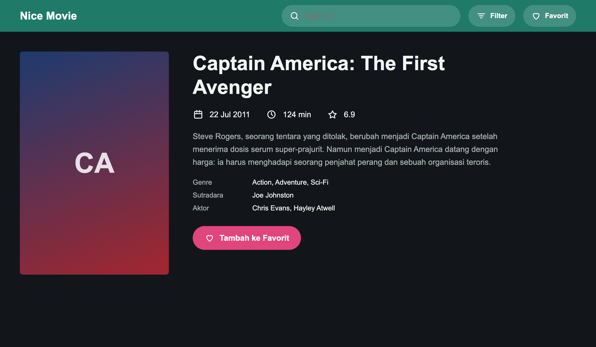

# 🖥️ desktopApp — Presentation Layer Fitur `detailMovies` (Compose Multiplatform Desktop + Koin)

Dokumen ini menjelaskan arsitektur dan spesifikasi implementasi **UI + ViewModel + DI + Navigasi** untuk layar detail film (**`detailMovie`**) pada platform **Desktop (Kotlin/JVM)**.

| Layer | Teknologi |
|---|---|
| UI | Compose Multiplatform Desktop (JVM) + Material 3 |
| State Holder | JetBrains Lifecycle `ViewModel` + `StateFlow<MovieDetailUiState>` |
| DI | Koin (`viewModel { (imdbId: String) -> DesktopMovieDetailViewModel(...) }`) |
| Navigasi | State-based (`DesktopMovieRoute.Detail(imdbId)`) |
| Keyboard Shortcut | Pintasan `Esc` untuk kembali ke layar daftar film |

---

## Desain UI



> Desain ini adalah **acuan visual UI**:
> - `destopApp-design.png`: Menampilkan layout 2 kolom window desktop (poster di sisi kiri, informasi metadata, rating, dan sinopsis lengkap di sisi kanan).

---

## 1. Spesifikasi Komponen Desktop

- **Layout 2 Kolom**:
  - Kolom Kiri (lebar tetap ±300dp): Poster film resolusi penuh dengan sudut rounded.
  - Kolom Kanan (fleksibel): Judul film, tahun rilis, badge rating IMDb/Metascore, genre, plot sinopsis, serta detail sutradara dan pemeran.
- **SelectionContainer**: Memungkinkan teks plot dan informasi metadata di-copy oleh pengguna desktop.
- **Keyboard Shortcut**: Menekan tombol `Esc` otomatis memicu aksi kembali ke layar daftar film.

---

## 2. ViewModel (`DesktopMovieDetailViewModel.kt`)

```kotlin
package me.test.project.moviekmp.feature.movie.presentation.detail

import androidx.lifecycle.ViewModel
import androidx.lifecycle.viewModelScope
import kotlinx.coroutines.flow.*
import kotlinx.coroutines.launch
import me.test.project.moviekmp.feature.movie.application.model.MovieDetail
import me.test.project.moviekmp.feature.movie.application.usecase.GetDetailMoviesUseCase

data class DesktopMovieDetailUiState(
    val isLoading: Boolean = true,
    val movie: MovieDetail? = null,
    val error: String? = null
)

class DesktopMovieDetailViewModel(
    private val imdbId: String,
    private val getDetailMoviesUseCase: GetDetailMoviesUseCase
) : ViewModel() {

    private val _state = MutableStateFlow(DesktopMovieDetailUiState())
    val state: StateFlow<DesktopMovieDetailUiState> = _state.asStateFlow()

    init {
        loadDetail()
    }

    fun loadDetail() {
        viewModelScope.launch {
            _state.update { it.copy(isLoading = true, error = null) }
            runCatching { getDetailMoviesUseCase(imdbId = imdbId) }
                .onSuccess { detail -> _state.update { it.copy(isLoading = false, movie = detail) } }
                .onFailure { e -> _state.update { it.copy(isLoading = false, error = e.message ?: "Gagal memuat detail film") } }
        }
    }
}
```

---

## 3. DI & Main Window Integration (`main.kt`)

```kotlin
val desktopMovieViewModelModule = module {
    viewModel { (imdbId: String) -> DesktopMovieDetailViewModel(imdbId, get()) }
}
```

```kotlin
when (val route = currentRoute) {
    is DesktopMovieRoute.Detail -> DesktopMovieDetailScreen(
        imdbId = route.imdbId,
        onBack = { currentRoute = DesktopMovieRoute.List }
    )
}
```

---

## 4. Ringkasan Struktur File Desktop

```
desktopApp/src/main/kotlin/me/test/project/moviekmp/
└── feature/movie/presentation/detail/
    ├── DesktopMovieDetailViewModel.kt
    └── DesktopMovieDetailScreen.kt
```
