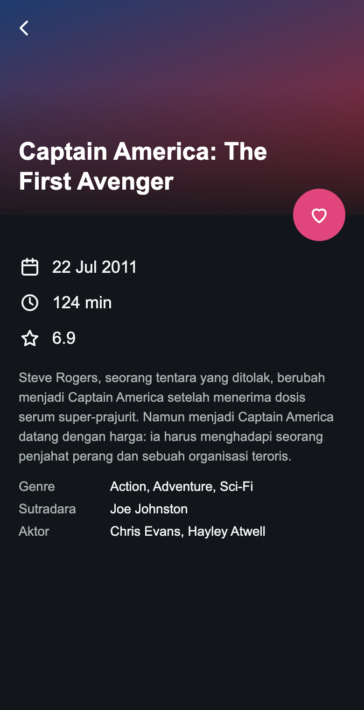

# 🍎 iosApp — Presentation Layer Fitur `detailMovies` (SwiftUI + `@Observable` + SKIE)

Dokumen ini menjelaskan arsitektur dan spesifikasi implementasi **UI + ViewModel + DI + Navigasi** untuk layar detail film (**`detailMovie`**) pada platform **iOS (SwiftUI)**.

| Layer | Teknologi |
|---|---|
| UI | SwiftUI (iOS 17+) |
| State Holder | `@Observable` class + `@MainActor` |
| DI | `KoinDependencies` (Kotlin) + `AppContainer` (Swift) via `@Environment` |
| Navigasi | `NavigationStack` + `MovieRoute.detail(imdbId)` |
| Interop Coroutines | SKIE (`suspend` → `async throws`) |

---

## Desain UI



> Desain ini adalah **acuan visual UI**:
> - `iosApp-design.png`: Menampilkan halaman detail film bergaya iOS native dengan hero poster, badge rating IMDb, section inset grouped metadata, dan sinopsis.

---

## 1. Container Swift (`AppContainer.swift`)

```swift
@MainActor
final class AppContainer {
    private let deps = KoinDependencies()

    func makeMovieDetailViewModel(imdbId: String) -> MovieDetailViewModel {
        MovieDetailViewModel(imdbId: imdbId, getDetailMoviesUseCase: deps.getDetailMoviesUseCase)
    }
}
```

---

## 2. ViewModel (`MovieDetailViewModel.swift`)

```swift
import Observation
import Shared

@Observable @MainActor
final class MovieDetailViewModel {
    var movie: MovieDetail?
    var isLoading = true
    var errorMessage: String?

    private let imdbId: String
    private let getDetailMoviesUseCase: any GetDetailMoviesUseCase

    init(imdbId: String, getDetailMoviesUseCase: any GetDetailMoviesUseCase) {
        self.imdbId = imdbId
        self.getDetailMoviesUseCase = getDetailMoviesUseCase
    }

    func loadDetail() async {
        isLoading = true
        errorMessage = nil
        defer { isLoading = false }

        do {
            // SKIE: suspend fun -> async throws
            movie = try await getDetailMoviesUseCase.invoke(imdbId: imdbId)
        } catch {
            errorMessage = error.localizedDescription
        }
    }
}
```

---

## 3. SwiftUI View (`MovieDetailView.swift`)

```swift
import SwiftUI
import Shared

struct MovieDetailView: View {
    @State var vm: MovieDetailViewModel

    var body: some View {
        ScrollView {
            if vm.isLoading {
                ProgressView("Memuat detail film...")
                    .padding(.top, 40)
            } else if let error = vm.errorMessage {
                VStack(spacing: 12) {
                    Text(error).foregroundStyle(.red)
                    Button("Coba Lagi") { Task { await vm.loadDetail() } }
                }
                .padding(.top, 40)
            } else if let movie = vm.movie {
                VStack(alignment: .leading, spacing: 16) {
                    // Hero Poster
                    AsyncImage(url: URL(string: movie.poster)) { image in
                        image.resizable().scaledToFit()
                    } placeholder: {
                        Rectangle().fill(Color.gray.opacity(0.3))
                    }
                    .frame(maxHeight: 350)
                    .clipShape(RoundedRectangle(cornerRadius: 16))

                    // Judul & Rating
                    Text(movie.title)
                        .font(.title.bold())
                    
                    HStack {
                        Label(movie.imdbRating, systemImage: "star.fill")
                            .foregroundStyle(.yellow)
                        Text("•")
                        Text(movie.runtime)
                        Text("•")
                        Text(movie.rated)
                    }
                    .font(.subheadline)
                    .foregroundStyle(.secondary)

                    // Sinopsis
                    VStack(alignment: .leading, spacing: 8) {
                        Text("Sinopsis").font(.headline)
                        Text(movie.plot).font(.body)
                    }

                    // Metadata Extra
                    VStack(alignment: .leading, spacing: 6) {
                        Text("Sutradara: \(movie.director)").font(.caption)
                        Text("Pemeran: \(movie.actors)").font(.caption)
                    }
                    .foregroundStyle(.secondary)
                }
                .padding()
            }
        }
        .navigationTitle("Detail Film")
        .navigationBarTitleDisplayMode(.inline)
        .task { await vm.loadDetail() }
    }
}
```

---

## 4. Ringkasan Struktur File iOS

```
iosApp/iosApp/
└── Feature/Movie/Detail/
    ├── MovieDetailViewModel.swift
    └── MovieDetailView.swift
```
