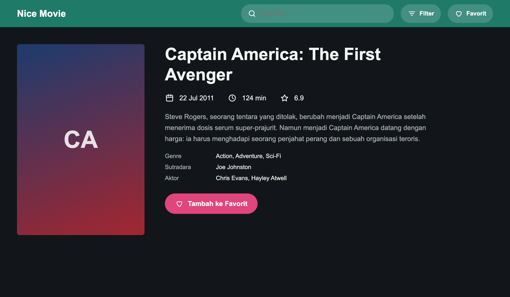

# 🌐 webApp — Presentation Layer Fitur `detailMovies` (React + TypeScript + Vite)

Dokumen ini menjelaskan arsitektur dan spesifikasi implementasi **UI + Custom Hook + DI + Navigasi** untuk layar detail film (**`detailMovie`**) pada platform **Web (React / Vite)**.

| Layer | Teknologi |
|---|---|
| Build | Vite 7 + React 18 + TypeScript |
| State Holder | Custom React Hook (`useMovieDetail`) |
| DI | `KmpFactory` + React Context (`<SharedProvider>`) |
| Navigasi | State-based / React Router (`movieDetail(imdbId)`) |

---

## Desain UI



> Desain ini adalah **acuan visual UI**:
> - `webApp-design.png`: Menampilkan halaman detail film web responsif dengan hero backdrop banner, poster, rating badge, sinopsis, dan daftar metadata.

---

## 1. Custom Hook (`useMovieDetail.ts`)

```ts
import { useEffect, useState } from 'react';
import type { MovieDetail } from 'shared';
import { useShared } from '../di/SharedProvider.tsx';

export function useMovieDetail(imdbId: string) {
  const shared = useShared();
  const [movie, setMovie] = useState<MovieDetail | null>(null);
  const [isLoading, setLoading] = useState(true);
  const [error, setError] = useState<string | null>(null);

  useEffect(() => {
    let active = true;
    setLoading(true);
    setError(null);

    shared.getGetDetailMoviesUseCase().invoke(imdbId)
      .then((detail) => {
        if (active) setMovie(detail);
      })
      .catch((e) => {
        if (active) setError(e instanceof Error ? e.message : String(e));
      })
      .finally(() => {
        if (active) setLoading(false);
      });

    return () => {
      active = false;
    };
  }, [shared, imdbId]);

  return { movie, isLoading, error };
}
```

---

## 2. Komponen UI (`MovieDetailScreen.tsx`)

```tsx
import { useMovieDetail } from '../hooks/useMovieDetail.ts';

export function MovieDetailScreen({ imdbId, onBack }: { imdbId: string; onBack: () => void }) {
  const { movie, isLoading, error } = useMovieDetail(imdbId);

  return (
    <div className="movie-detail-container">
      <button type="button" onClick={onBack} className="btn-back">
        ← Kembali ke Daftar Film
      </button>

      {isLoading && <div className="spinner">Memuat detail film...</div>}
      {error && <div className="error-message">{error}</div>}

      {movie && (
        <article className="movie-detail-content">
          <div className="poster-wrapper">
            
          </div>
          <div className="info-wrapper">
            <h1>{movie.title} ({movie.year})</h1>
            <div className="badges">
              <span className="badge rating">★ {movie.imdbRating}</span>
              <span className="badge rated">{movie.rated}</span>
              <span className="badge runtime">{movie.runtime}</span>
              <span className="badge genre">{movie.genre}</span>
            </div>
            <section className="plot-section">
              <h2>Sinopsis</h2>
              <p>{movie.plot}</p>
            </section>
            <section className="cast-section">
              <p><strong>Sutradara:</strong> {movie.director}</p>
              <p><strong>Penulis:</strong> {movie.writer}</p>
              <p><strong>Pemeran:</strong> {movie.actors}</p>
            </section>
          </div>
        </article>
      )}
    </div>
  );
}
```

---

## 3. Ringkasan Struktur File Web

```
webApp/src/
└── feature/movie/
    ├── hooks/
    │   └── useMovieDetail.ts
    └── screens/
        └── MovieDetailScreen.tsx
```
