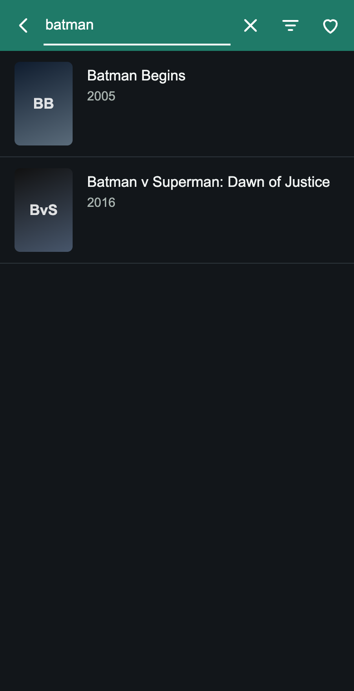

# 📱 androidApp — Presentation Layer Fitur `listMovies` (Jetpack Compose + AndroidX ViewModel + Koin)

Dokumen ini menjelaskan arsitektur dan spesifikasi implementasi **UI + ViewModel + DI + Navigasi** untuk fitur **`listMovies`** (Daftar & Pencarian Film OMDb) dan **`detailMovie`** pada platform **Android**.

| Layer | Teknologi |
|---|---|
| UI | Jetpack Compose + Material 3 |
| State Holder | AndroidX `ViewModel` + `StateFlow<UiState>` |
| DI | Koin (`viewModelOf`, `koinViewModel()`) |
| Navigasi | Navigation Compose (type-safe route `@Serializable`) |
| Image Loading | Coil Compose (`AsyncImage`) |

---

## Desain UI




> Desain ini adalah **acuan visual UI**:
> - `androidApp-design.png`: Menampilkan daftar film utama dan halaman detail film.
> - `androidApp-designSearch.png`: Menampilkan antarmuka pencarian film beserta filter tipe (`movie`, `series`, `episode`).

---

## 1. Desain UI & Token Warna

### Token Desain

| Token | Nilai | Pemakaian |
|---|---|---|
| Primary | Gold / Amber (`#F5C518` / `Color(0xFFF5C518)`) | Brand OMDb / IMDb, Tombol Cari, Highlight Rating |
| Background | Dark Neutral (`#121212` / `Color(0xFF121212)`) | Background utama aplikasi |
| Surface / Card | Dark Surface (`#1E1E1E` / `Color(0xFF1E1E1E)`) | Card film, TopBar, BottomBar |
| Text Primary | Putih (`#FFFFFF`) | Judul film, header |
| Text Secondary | Abu-abu terang (`#B0B0B0`) | Tahun rilis, tipe (`movie`/`series`), genre |

---

## 2. Struktur Layar

### A. Layar Daftar Film (`MovieListScreen`)
1. **TopBar / SearchBar**: `OutlinedTextField` bentuk pill dengan tombol cari (ikon `Search`) untuk melakukan query judul ke OMDb API.
2. **Filter Chip**: Pilihan tipe `All`, `Movie`, `Series`, `Episode`.
3. **Grid Kartu Film (`LazyVerticalGrid`)**: 2 kolom di HP (3-4 kolom di tablet):
   - Poster film (`AsyncImage` dengan placeholder/error icon).
   - Judul film (maksimal 2 baris, `TextOverflow.Ellipsis`).
   - Tahun rilis & tipe badge (mis. `2008` • `MOVIE`).
4. **State Handling**:
   - **Loading**: `CircularProgressIndicator` di tengah layar.
   - **Empty State**: Pesan *"Film tidak ditemukan"* bila pencarian tidak menghasilkan data.
   - **Error State**: Pesan error OMDb API (mis. *"Too many results"* / *"Movie not found!"*) dilengkapi tombol **Coba Lagi**.

### B. Layar Detail Film (`MovieDetailScreen`)
1. **Header / Hero Poster**: Gambar poster utama ukuran besar (rasio 2:3) dengan gradien gelap di bawahnya.
2. **Metadata Utama**: Judul, tahun rilis, rating usia (`Rated`), durasi (`Runtime`), dan genre.
3. **Rating Section**: Display rating IMDb (contoh `★ 9.0/10`) dan Metascore.
4. **Sinopsis (`Plot`)**: Teks alur cerita film (`short` atau `full`).
5. **Informasi Tambahan**: Sutradara (`Director`), Penulis (`Writer`), dan Pemeran (`Actors`).

---

## 3. Dependency (`androidApp/build.gradle.kts`)

```kotlin
plugins {
    alias(libs.plugins.androidApplication)
    alias(libs.plugins.composeCompiler)
    alias(libs.plugins.kotlinSerialization)
}

dependencies {
    implementation(project(":sharedLogic"))

    implementation(libs.compose.runtime)
    implementation(libs.compose.foundation)
    implementation(libs.compose.ui)
    implementation(libs.compose.material3)
    implementation(libs.androidx.activity.compose)
    implementation(libs.androidx.lifecycle.viewmodelCompose)
    implementation(libs.androidx.lifecycle.runtimeCompose)
    implementation(libs.androidx.navigation.compose)

    implementation(libs.koin.android)
    implementation(libs.koin.androidx.compose)
}
```

---

## 4. ViewModel (State Holder)

### 4.1 `MovieListViewModel`

```kotlin
package me.test.project.moviekmp.feature.movie.presentation.list

import androidx.lifecycle.ViewModel
import androidx.lifecycle.viewModelScope
import kotlinx.coroutines.FlowPreview
import kotlinx.coroutines.flow.*
import kotlinx.coroutines.launch
import me.test.project.moviekmp.feature.movie.domain.model.MovieItem
import me.test.project.moviekmp.feature.movie.domain.usecase.SearchMoviesUseCase

data class MovieListUiState(
    val query: String = "Batman",
    val selectedType: String = "",
    val isLoading: Boolean = false,
    val movies: List<MovieItem> = emptyList(),
    val error: String? = null,
)

class MovieListViewModel(
    private val searchMoviesUseCase: SearchMoviesUseCase
) : ViewModel() {

    private val _state = MutableStateFlow(MovieListUiState())
    val state: StateFlow<MovieListUiState> = _state.asStateFlow()

    init {
        searchMovies(_state.value.query, _state.value.selectedType)
    }

    fun onQueryChange(newQuery: String) {
        _state.update { it.copy(query = newQuery, error = null) }
    }

    fun onTypeSelected(type: String) {
        _state.update { it.copy(selectedType = type) }
        searchMovies(_state.value.query, type)
    }

    fun search() {
        searchMovies(_state.value.query, _state.value.selectedType)
    }

    private fun searchMovies(query: String, type: String) {
        if (query.isBlank()) return
        viewModelScope.launch {
            _state.update { it.copy(isLoading = true, error = null) }
            runCatching { searchMoviesUseCase(query = query, type = type) }
                .onSuccess { list ->
                    _state.update { it.copy(isLoading = false, movies = list) }
                }
                .onFailure { e ->
                    _state.update { it.copy(isLoading = false, error = e.message ?: "Terjadi kesalahan") }
                }
        }
    }
}
```

### 4.2 `MovieDetailViewModel`

```kotlin
package me.test.project.moviekmp.feature.movie.presentation.detail

import androidx.lifecycle.ViewModel
import androidx.lifecycle.viewModelScope
import kotlinx.coroutines.flow.*
import kotlinx.coroutines.launch
import me.test.project.moviekmp.feature.movie.domain.model.MovieDetail
import me.test.project.moviekmp.feature.movie.domain.usecase.GetMovieDetailUseCase

data class MovieDetailUiState(
    val isLoading: Boolean = true,
    val movie: MovieDetail? = null,
    val error: String? = null,
)

class MovieDetailViewModel(
    private val imdbId: String,
    private val getMovieDetailUseCase: GetMovieDetailUseCase
) : ViewModel() {

    private val _state = MutableStateFlow(MovieDetailUiState())
    val state: StateFlow<MovieDetailUiState> = _state.asStateFlow()

    init {
        loadDetail()
    }

    fun loadDetail() {
        viewModelScope.launch {
            _state.update { it.copy(isLoading = true, error = null) }
            runCatching { getMovieDetailUseCase(imdbId) }
                .onSuccess { detail ->
                    _state.update { it.copy(isLoading = false, movie = detail) }
                }
                .onFailure { e ->
                    _state.update { it.copy(isLoading = false, error = e.message ?: "Gagal memuat detail") }
                }
        }
    }
}
```

---

## 5. Dependency Injection (Koin)

```kotlin
package me.test.project.moviekmp.di

import me.test.project.moviekmp.feature.movie.presentation.detail.MovieDetailViewModel
import me.test.project.moviekmp.feature.movie.presentation.list.MovieListViewModel
import org.koin.core.module.dsl.viewModelOf
import org.koin.dsl.module

val androidMovieViewModelModule = module {
    viewModelOf(::MovieListViewModel)
    viewModel { (imdbId: String) -> MovieDetailViewModel(imdbId, get()) }
}
```

---

## 6. Navigasi (`AppNavigation.kt`)

```kotlin
package me.test.project.moviekmp.nav

import androidx.compose.runtime.Composable
import androidx.navigation.compose.NavHost
import androidx.navigation.compose.composable
import androidx.navigation.compose.rememberNavController
import androidx.navigation.toRoute
import kotlinx.serialization.Serializable
import me.test.project.moviekmp.feature.movie.presentation.detail.MovieDetailScreen
import me.test.project.moviekmp.feature.movie.presentation.list.MovieListScreen

@Serializable data object MovieListRoute
@Serializable data class MovieDetailRoute(val imdbId: String)

@Composable
fun AppNavigation() {
    val navController = rememberNavController()

    NavHost(navController = navController, startDestination = MovieListRoute) {
        composable<MovieListRoute> {
            MovieListScreen(
                onMovieClick = { imdbId ->
                    navController.navigate(MovieDetailRoute(imdbId))
                }
            )
        }
        composable<MovieDetailRoute> { entry ->
            val route = entry.toRoute<MovieDetailRoute>()
            MovieDetailScreen(
                imdbId = route.imdbId,
                onBackClick = { navController.popBackStack() }
            )
        }
    }
}
```

---

## 7. Ringkasan Struktur File Android

```
androidApp/src/main/kotlin/me/test/project/moviekmp/
├── MainApplication.kt                   # startKoin { androidContext; modules(sharedModule + androidMovieViewModelModule) }
├── MainActivity.kt                      # setContent { AppNavigation() }
├── di/AndroidMovieModule.kt             # MovieListViewModel + MovieDetailViewModel(imdbId)
├── nav/AppNavigation.kt                 # MovieListRoute, MovieDetailRoute(imdbId)
└── feature/movie/presentation/
    ├── list/
    │   ├── MovieListViewModel.kt
    │   ├── MovieListScreen.kt
    │   └── components/MovieCard.kt
    └── detail/
        ├── MovieDetailViewModel.kt
        └── MovieDetailScreen.kt
```
