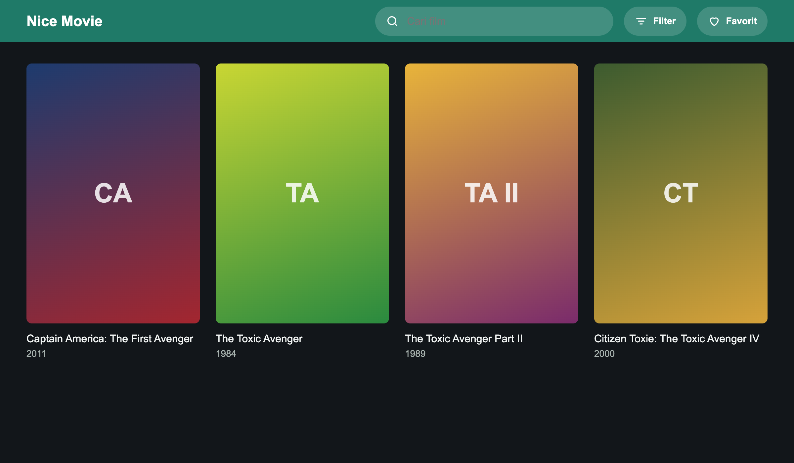
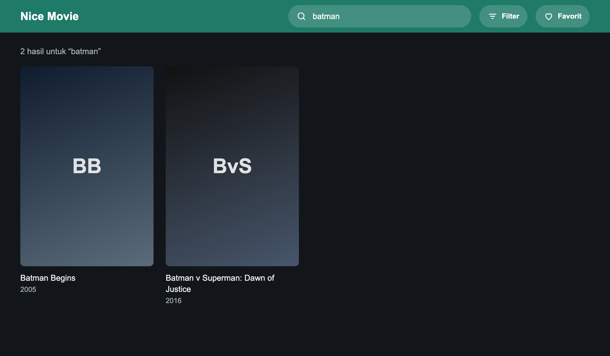

# 🖥️ desktopApp — Presentation Layer Fitur `listMovies` (Compose Multiplatform Desktop + Koin)

Dokumen ini menjelaskan arsitektur dan spesifikasi implementasi **UI + ViewModel + DI + Navigasi** untuk fitur **`listMovies`** dan **`detailMovie`** pada platform **Desktop (Kotlin/JVM)**.

| Layer | Teknologi |
|---|---|
| UI | Compose Multiplatform Desktop (JVM) + Material 3 |
| State Holder | JetBrains Lifecycle `ViewModel` + `StateFlow<UiState>` |
| DI | Koin (`viewModelOf`, `koinViewModel()`) |
| Navigasi | State-based (`sealed interface DesktopMovieRoute`) |
| Keyboard Shortcut | Key event handlers (`Enter` untuk cari, `Esc` untuk kembali) |

---

## Desain UI




> Desain ini adalah **acuan visual UI**:
> - `desktopApp-design.png`: Menampilkan layout window desktop untuk daftar film utama dan detail film.
> - `desktopApp-designSearch.png`: Menampilkan antarmuka pencarian film dengan dukungan keyboard shortcut.

---

## 1. Spesifikasi Layar Desktop

- **Ukuran Window Default**: 900 × 700 pixel (dapat di-resize responsif).
- **Grid Layout**: 3 hingga 5 kolom bergantung pada lebar Window (`LazyVerticalGrid`).
- **Scroll Integration**: Scrollbar bawaan Swing/Compose Desktop di samping kanan daftar film.
- **Keyboard Shortcut**:
  - `Enter` saat mengetik query pencarian langsung memicu pencarian.
  - `Esc` pada layar Detail Film otomatis kembali ke layar Daftar Film.

---

## 2. Navigasi & Window Entry Point (`main.kt`)

```kotlin
package me.test.project.moviekmp

import androidx.compose.material3.MaterialTheme
import androidx.compose.runtime.*
import androidx.compose.ui.unit.dp
import androidx.compose.ui.window.Window
import androidx.compose.ui.window.application
import androidx.compose.ui.window.rememberWindowState
import me.test.project.moviekmp.core.sharedModule
import me.test.project.moviekmp.di.desktopMovieViewModelModule
import me.test.project.moviekmp.feature.movie.presentation.detail.DesktopMovieDetailScreen
import me.test.project.moviekmp.feature.movie.presentation.list.DesktopMovieListScreen
import org.koin.core.context.startKoin

sealed interface DesktopMovieRoute {
    data object List : DesktopMovieRoute
    data class Detail(val imdbId: String) : DesktopMovieRoute
}

fun main() {
    startKoin {
        modules(sharedModule + desktopMovieViewModelModule)
    }

    application {
        Window(
            onCloseRequest = ::exitApplication,
            title = "MovieKMP Desktop",
            state = rememberWindowState(width = 900.dp, height = 700.dp)
        ) {
            var currentRoute by remember { mutableStateOf<DesktopMovieRoute>(DesktopMovieRoute.List) }

            MaterialTheme {
                when (val route = currentRoute) {
                    DesktopMovieRoute.List -> DesktopMovieListScreen(
                        onMovieClick = { imdbId -> currentRoute = DesktopMovieRoute.Detail(imdbId) }
                    )
                    is DesktopMovieRoute.Detail -> DesktopMovieDetailScreen(
                        imdbId = route.imdbId,
                        onBack = { currentRoute = DesktopMovieRoute.List }
                    )
                }
            }
        }
    }
}
```

---

## 3. ViewModel (State Holder)

### 3.1 `DesktopMovieListViewModel`

```kotlin
package me.test.project.moviekmp.feature.movie.presentation.list

import androidx.lifecycle.ViewModel
import androidx.lifecycle.viewModelScope
import kotlinx.coroutines.flow.*
import kotlinx.coroutines.launch
import me.test.project.moviekmp.feature.movie.domain.model.MovieItem
import me.test.project.moviekmp.feature.movie.domain.usecase.SearchMoviesUseCase

data class DesktopMovieListUiState(
    val query: String = "Avengers",
    val isLoading: Boolean = false,
    val movies: List<MovieItem> = emptyList(),
    val error: String? = null
)

class DesktopMovieListViewModel(
    private val searchMoviesUseCase: SearchMoviesUseCase
) : ViewModel() {

    private val _state = MutableStateFlow(DesktopMovieListUiState())
    val state: StateFlow<DesktopMovieListUiState> = _state.asStateFlow()

    init {
        search()
    }

    fun onQueryChange(value: String) {
        _state.update { it.copy(query = value, error = null) }
    }

    fun search() {
        val query = _state.value.query.trim()
        if (query.isEmpty()) return
        viewModelScope.launch {
            _state.update { it.copy(isLoading = true, error = null) }
            runCatching { searchMoviesUseCase(query = query) }
                .onSuccess { list -> _state.update { it.copy(isLoading = false, movies = list) } }
                .onFailure { e -> _state.update { it.copy(isLoading = false, error = e.message ?: "Gagal mencari film") } }
        }
    }
}
```

---

## 4. DI (Koin Desktop Module)

```kotlin
package me.test.project.moviekmp.di

import me.test.project.moviekmp.feature.movie.presentation.detail.DesktopMovieDetailViewModel
import me.test.project.moviekmp.feature.movie.presentation.list.DesktopMovieListViewModel
import org.koin.core.module.dsl.viewModelOf
import org.koin.dsl.module

val desktopMovieViewModelModule = module {
    viewModelOf(::DesktopMovieListViewModel)
    viewModel { (imdbId: String) -> DesktopMovieDetailViewModel(imdbId, get()) }
}
```

---

## 5. Ringkasan Struktur File Desktop

```
desktopApp/src/main/kotlin/me/test/project/moviekmp/
├── main.kt                                   # startKoin + Window + DesktopMovieRoute
├── di/DesktopMovieModule.kt                  # Koin Desktop ViewModel Module
└── feature/movie/presentation/
    ├── list/
    │   ├── DesktopMovieListViewModel.kt
    │   └── DesktopMovieListScreen.kt
    └── detail/
        ├── DesktopMovieDetailViewModel.kt
        └── DesktopMovieDetailScreen.kt
```
