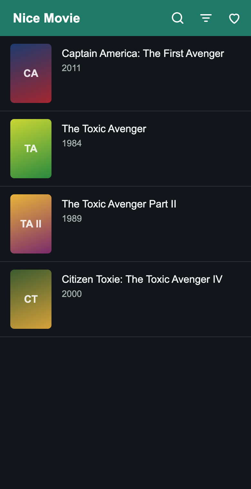
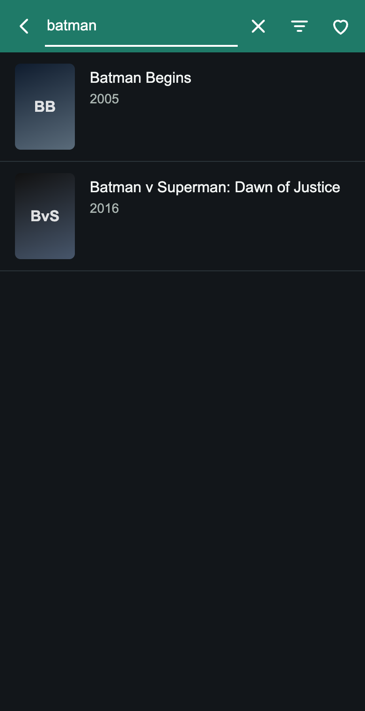

# 🍎 iosApp — Presentation Layer Fitur `listMovies` (SwiftUI + `@Observable` + SKIE)

Dokumen ini menjelaskan arsitektur dan spesifikasi implementasi **UI + ViewModel + DI + Navigasi** untuk fitur **`listMovies`** dan **`detailMovie`** pada platform **iOS (SwiftUI)**.

| Layer | Teknologi |
|---|---|
| UI | SwiftUI (iOS 17+) |
| State Holder | `@Observable` class + `@MainActor` |
| DI | `KoinDependencies` (Kotlin) + `AppContainer` (Swift) via `@Environment` |
| Navigasi | `NavigationStack` + `enum MovieRoute` |
| Interop Coroutines | SKIE (`suspend` → `async throws`, `Flow` → `AsyncSequence`) |

---

## Desain UI




> Desain ini adalah **acuan visual UI**:
> - `iosApp-design.png`: Menampilkan antarmuka SwiftUI untuk daftar film utama dan detail film.
> - `iosApp-designSearch.png`: Menampilkan antarmuka pencarian film native dengan `.searchable`.

---

## 1. DI & Container Swift (`AppContainer.swift`)

```swift
import Shared

@MainActor
final class AppContainer {
    private let deps = KoinDependencies()

    func makeMovieListViewModel() -> MovieListViewModel {
        MovieListViewModel(searchMoviesUseCase: deps.searchMoviesUseCase)
    }

    func makeMovieDetailViewModel(imdbId: String) -> MovieDetailViewModel {
        MovieDetailViewModel(imdbId: imdbId, getMovieDetailUseCase: deps.getMovieDetailUseCase)
    }
}
```

---

## 2. ViewModel (`@Observable`)

### 2.1 `MovieListViewModel.swift`

```swift
import Observation
import Shared

@Observable @MainActor
final class MovieListViewModel {
    var query = "Batman"
    var selectedType = ""
    var isLoading = false
    var movies: [MovieItem] = []
    var errorMessage: String?

    private let searchMoviesUseCase: any SearchMoviesUseCase

    init(searchMoviesUseCase: any SearchMoviesUseCase) {
        self.searchMoviesUseCase = searchMoviesUseCase
    }

    func search() async {
        let trimmed = query.trimmingCharacters(in: .whitespaces)
        guard !trimmed.isEmpty else { return }
        isLoading = true
        errorMessage = nil
        defer { isLoading = false }

        do {
            // SKIE: suspend fun -> async throws
            movies = try await searchMoviesUseCase.invoke(query: trimmed, type: selectedType)
        } catch {
            errorMessage = error.localizedDescription
        }
    }
}
```

---

## 3. Navigasi & View SwiftUI

### 3.1 `MovieListView.swift`

```swift
import SwiftUI
import Shared

struct MovieListView: View {
    @Bindable var vm: MovieListViewModel
    let onMovieSelected: (String) -> Void

    private let columns = [GridItem(.adaptive(minimum: 150), spacing: 16)]

    var body: some View {
        ScrollView {
            if vm.isLoading {
                ProgressView("Memuat film...")
                    .padding(.top, 40)
            } else if let error = vm.errorMessage {
                VStack(spacing: 12) {
                    Text(error).foregroundStyle(.red)
                    Button("Coba Lagi") { Task { await vm.search() } }
                }
                .padding(.top, 40)
            } else {
                LazyVGrid(columns: columns, spacing: 16) {
                    ForEach(vm.movies, id: \.imdbId) { movie in
                        MovieCard(movie: movie)
                            .onTapGesture {
                                onMovieSelected(movie.imdbId)
                            }
                    }
                }
                .padding()
            }
        }
        .navigationTitle("MovieKMP")
        .searchable(text: $vm.query, prompt: "Cari film...")
        .onSubmit(of: .search) {
            Task { await vm.search() }
        }
        .task {
            if vm.movies.isEmpty {
                await vm.search()
            }
        }
    }
}
```

---

## 4. Ringkasan Struktur File iOS

```
iosApp/iosApp/
├── iOSApp.swift                        # doInitKoinIos() + AppContainer
├── RootView.swift                      # NavigationStack + MovieRoute
├── DI/AppContainer.swift
└── Feature/Movie/
    ├── List/
    │   ├── MovieListViewModel.swift
    │   ├── MovieListView.swift
    │   └── MovieCardView.swift
    └── Detail/
        ├── MovieDetailViewModel.swift
        └── MovieDetailView.swift
```
