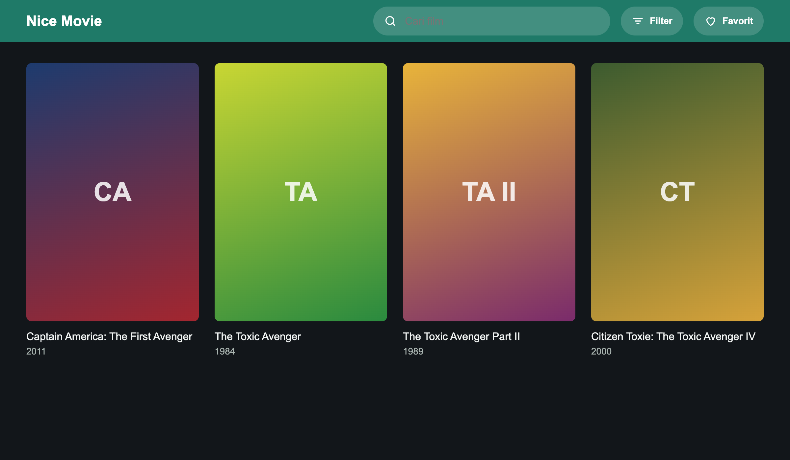
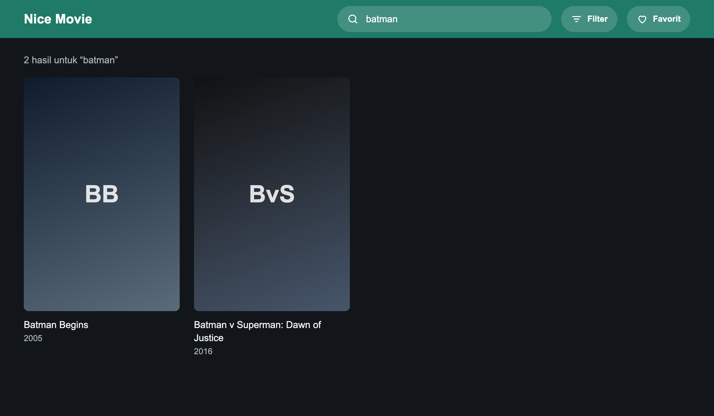

# 🌐 webApp — Presentation Layer Fitur `listMovies` (React + TypeScript + Vite)

Dokumen ini menjelaskan arsitektur dan spesifikasi implementasi **UI + Custom Hooks + DI + Navigasi** untuk fitur **`listMovies`** dan **`detailMovie`** pada platform **Web (React / Vite)**.

| Layer | Teknologi |
|---|---|
| Build | Vite 7 + React 18 + TypeScript |
| State Holder | Custom React Hooks (`useMovieList`, `useMovieDetail`) |
| DI | `KmpFactory` + React Context (`<SharedProvider>`) |
| Navigasi | State-based / React Router (`movieList` → `movieDetail`) |

---

## Desain UI




> Desain ini adalah **acuan visual UI**:
> - `webApp-design.png`: Menampilkan antarmuka web responsif untuk daftar film utama dan detail film.
> - `webApp-designSearch.png`: Menampilkan antarmuka pencarian film dengan search bar dan filter.

---

## 1. Custom Hooks (ViewModel Web)

### 1.1 `useMovieList.ts`

```ts
import { useCallback, useEffect, useState } from 'react';
import type { MovieItem } from 'shared';
import { useShared } from '../di/SharedProvider.tsx';

export function useMovieList() {
  const shared = useShared();
  const [query, setQuery] = useState('Batman');
  const [movies, setMovies] = useState<MovieItem[]>([]);
  const [isLoading, setLoading] = useState(false);
  const [error, setError] = useState<string | null>(null);

  const search = useCallback(async (searchQuery?: string) => {
    const q = (searchQuery ?? query).trim();
    if (!q) return;
    setLoading(true);
    setError(null);
    try {
      const result = await shared.getSearchMoviesUseCase().invoke(q, '');
      setMovies(result);
    } catch (e) {
      setError(e instanceof Error ? e.message : String(e));
    } finally {
      setLoading(false);
    }
  }, [shared, query]);

  useEffect(() => {
    search('Batman');
  }, [search]);

  return { query, setQuery, movies, isLoading, error, search };
}
```

---

## 2. Komponen UI (`MovieListScreen.tsx`)

```tsx
import { useMovieList } from '../hooks/useMovieList.ts';

export function MovieListScreen({ onMovieSelect }: { onMovieSelect: (imdbId: string) => void }) {
  const { query, setQuery, movies, isLoading, error, search } = useMovieList();

  return (
    <div className="movie-list-container">
      <header className="search-header">
        <h1>MovieKMP</h1>
        <form onSubmit={(e) => { e.preventDefault(); search(); }}>
          <input
            type="text"
            placeholder="Cari judul film..."
            value={query}
            onChange={(e) => setQuery(e.target.value)}
          />
          <button type="submit">Cari</button>
        </form>
      </header>

      {isLoading && <div className="spinner">Memuat film...</div>}
      {error && <div className="error-message">{error}</div>}

      <main className="movie-grid">
        {movies.map((movie) => (
          <div key={movie.imdbId} className="movie-card" onClick={() => onMovieSelect(movie.imdbId)}>
            
            <div className="movie-info">
              <h3>{movie.title}</h3>
              <p>{movie.year} • {movie.type.toUpperCase()}</p>
            </div>
          </div>
        ))}
      </main>
    </div>
  );
}
```

---

## 3. Ringkasan Struktur File Web

```
webApp/src/
├── index.tsx                         # <SharedProvider><App /></SharedProvider>
├── App.tsx                           # Route state: movieList -> movieDetail(imdbId)
├── di/SharedProvider.tsx             # Context + KmpFactory.getInstance()
└── feature/movie/
    ├── hooks/
    │   ├── useMovieList.ts
    │   └── useMovieDetail.ts
    └── screens/
        ├── MovieListScreen.tsx
        └── MovieDetailScreen.tsx
```
