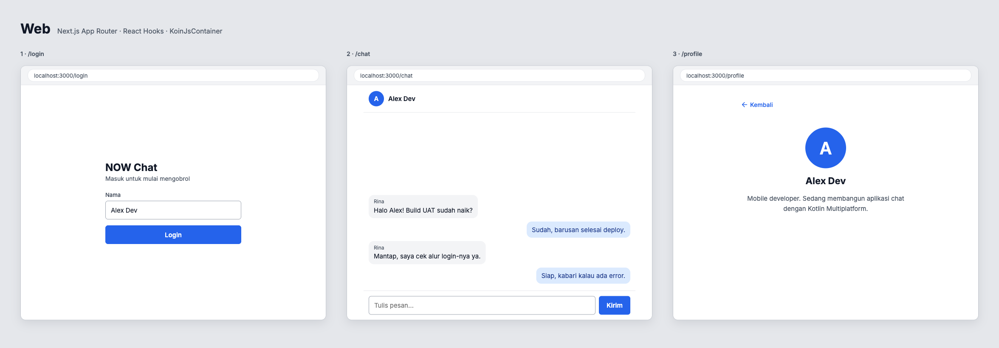

#  webApp — Presentation Layer (Vite + React + TypeScript + Hooks)

Rencana implementasi **UI + "ViewModel" + DI** untuk aplikasi Chat di **Web**. Modul `shared` (model, `ChatRepositoryImpl` in-memory, 4 UseCase, `sharedModule`) **sudah tersedia** dan dikompilasi ke Kotlin/JS (`binaries.library()` + `generateTypeScriptDefinitions()`) sebagai package npm **`shared`** — lihat [`docs/feature/shared/shared-kmp.md`](../shared/shared-kmp.md).

| Layer | Teknologi |
|---|---|
| Build | Vite 7 + React 18 + TypeScript (sudah ada di `webApp/`) |
| State holder | Custom React Hooks (`useLogin`, `useChat`, `useProfile`) |
| DI | `KmpFactory` (Kotlin/JS, sudah ada) + React Context (`<SharedProvider>`) |
| Navigasi | State-based di `App.tsx` (`login` → `chat` → `profile`), tanpa router tambahan |

---

## Desain UI (Redesign)



> Desain ini adalah **acuan redesign** dan **sudah diterapkan** di `webApp` (`src/App.css`, `src/screens/*`, `src/components/Avatar/Avatar.tsx`, `index.html`). Contoh kode UI di Bagian 5 masih versi sebelum redesign; implementasi di repo adalah acuannya. Hooks dan `SharedProvider` **tidak berubah**.

> ⚠️ Label desain menyebut *"Next.js App Router · KoinJsContainer"* dan URL `localhost:3000/...`. Implementasi nyata adalah **Vite + React + `KmpFactory`** di port **8080** (lihat Bagian 1 & 6). Yang diambil dari desain adalah **tampilan**, bukan teknologinya. URL per layar (`/login`, `/chat`, `/profile`) butuh router — lihat checklist.

### Token desain

| Token | Nilai | Pemakaian |
|---|---|---|
| Primary | biru `#2563eb` | tombol Login & Kirim, avatar, link "Kembali" |
| Bubble saya | biru muda (`#dbeafe`) + teks biru tua (`#1e3a8a`) | pesan `isMine = true`, rata kanan |
| Bubble lawan | abu `#f3f4f6` + teks gelap | pesan lawan, rata kiri, nama pengirim kecil di dalam bubble |
| Radius | ±6px (input/tombol), ±10px (bubble) | |
| Font | **Inter** (400/500/600/700) via `@fontsource/inter`, di-bundle bersama app | semua teks |

### 1 · /login
- Blok form **rata kiri** dengan lebar ±270px, ditempatkan di tengah halaman. **Tanpa logo.**
- Judul **"NOW Chat"** (bold, ±20px) + subjudul "Masuk untuk mulai mengobrol" (kecil).
- Label **"Nama"** di atas input; input bordered lebar penuh.
- Tombol **Login** biru lebar penuh, radius kecil.

### 2 · /chat
- **Full-width dengan gutter 32px**: header, daftar pesan, dan input memenuhi lebar jendela, tetapi garis header/footer menjorok 32px dari tepi seperti desain; konten di dalamnya ber-padding 10px. Di jendela ±610px seperti frame desain, tampilannya sama dengan desain; di layar lebar tidak dibatasi kolom. Bubble tetap maks 75% lebar.
- Header: avatar inisial biru + nama **bold**, garis pemisah bawah. Klik → Profil.
- Daftar pesan menempel ke bawah; nama pengirim kecil di dalam bubble lawan.
- Footer: garis pemisah atas, input bordered **"Tulis pesan..."** (tinggi 37px) + tombol **"Kirim"** biru (tinggi 37px, lebar min 63px). Tombol tetap **solid** walau input kosong (input kosong diabaikan oleh `send()`); hanya nonaktif saat mengirim.

### 3 · /profile
- Kolom konten di tengah, lebar ±336px (`max-width: 384px` + padding 24px). Link **"Kembali"** biru dengan **ikon panah SVG** (bukan karakter ←), sejajar tepi kiri kolom.
- Avatar inisial besar (±80px) di tengah, nama bold, bio rata tengah (abu).

### Responsif

| Lebar layar | Perilaku |
|---|---|
| **> 640px** (desktop/tablet) | Tampilan desain: chat full-width dengan gutter 32px, kontrol 37px. Bubble maks `min(75%, 640px)` agar baris tidak terlalu panjang di monitor lebar. |
| **≤ 640px** (mobile) | Chat edge-to-edge (tanpa gutter), bubble maks 85%, input & tombol 40px (target sentuh), teks input 16px (mencegah auto-zoom iOS Safari), padding mengikuti `env(safe-area-inset-*)` iPhone. |
| Semua | Tinggi halaman `100dvh` (mengikuti address bar browser mobile), `viewport-fit=cover`, form login `max-width` (menyesuaikan layar sempit), kata/URL panjang dipatah (`overflow-wrap: anywhere`). |

### Perubahan dari implementasi saat ini
- [x] Login: tambah label "Nama", subjudul, dan layout form rata kiri; tombol lebar penuh.
- [x] Chat: header dengan garis pemisah; bubble lawan abu, bubble saya biru muda dengan teks biru tua; footer bergaris atas.
- [x] Profil: link "← Kembali" bergaya link (bukan tombol biasa).
- [x] **Avatar selalu inisial** sesuai desain. Catatan: `shared` mengisi `avatarUrl` (pravatar), sehingga `Avatar` sekarang menampilkan foto. Jika tetap ingin foto, inisial jadi fallback.
- [ ] (Opsional) **URL per layar** seperti desain: tambah `react-router-dom` dan ganti `switch` di `App.tsx` dengan `<Routes>`. `userId` perlu ikut di state router atau query (`/chat?userId=u1`), karena reload tetap mengembalikan ke login (sesi in-memory).
- [ ] Data contoh di desain (Rina, "Build UAT…") hanya ilustrasi; data nyata berasal dari `ChatRepositoryImpl` di `shared`.

---

## 1. Prasyarat: API JS dari `shared` (sudah ada)

TypeScript tidak bisa memanggil `suspend` atau mengoleksi `Flow` secara langsung. `shared` sudah menyediakan jembatannya di `shared/src/jsMain/kotlin/me/poc/kmpchat/chat/`:

- **`suspend` → `Promise`**: `LoginUseCase`, `GetProfileUseCase`, `SendMessageUseCase` di-`@JsExport`, sehingga `invoke()` mengembalikan `Promise`.
- **`Flow` → callback**: `JsObserveChatMessagesUseCase.subscribe(cb)` mengembalikan `JsSubscription` dengan `unsubscribe()`.
- **Model** `UserProfile` dan `ChatMessage` di-`@JsExport` langsung, jadi **tidak perlu DTO JS**.
- **`KmpFactory`** (`object`) memberi getter use case dan men-start Koin secara **lazy** — tidak ada fungsi `init()`.

Potongan `.d.ts` hasil generate (`shared/build/dist/js/developmentLibrary/shared.d.mts`):

```ts
export declare class UserProfile { get id(): string; get name(): string; get bio(): string; get avatarUrl(): string; }
export declare class ChatMessage { get id(): string; get senderName(): string; get message(): string; get isMine(): boolean; get timestamp(): bigint; }
export declare interface LoginUseCase { invoke(username: string): Promise<UserProfile>; }
export declare interface GetProfileUseCase { invoke(userId: string): Promise<UserProfile>; }
export declare interface SendMessageUseCase { invoke(text: string): Promise<void>; }
export declare class JsSubscription { unsubscribe(): void; }
export declare class JsObserveChatMessagesUseCase { subscribe(onData: (p0: Array<ChatMessage>) => void): JsSubscription; }
// KmpFactory.getInstance(): { getLoginUseCase(), getGetProfileUseCase(), getObserveChatMessagesUseCase(), getSendMessageUseCase() }
```

> `timestamp` bertipe **`bigint`** (flag `-Xes-long-as-bigint`). Pakai `Number(m.timestamp)` untuk `new Date(...)`.

> `avatarUrl` **non-null** (`string`). Cek string kosong, bukan `null`.

---

## 2. Prinsip

1. **Satu hook per layar:** `useLogin`, `useChat`, `useProfile`. Hook berperan sebagai ViewModel: menyimpan state dan mengekspos aksi.
2. **Komponen layar hanya merender** dan memanggil aksi dari hook. Tidak ada pemanggilan `KmpFactory` langsung di JSX.
3. **Logika bisnis tetap di `shared`.** Validasi username ada di `LoginUseCase`; `Promise` akan reject dengan pesan "Username tidak boleh kosong".
4. **Stream chat** di-subscribe di `useEffect` dan **di-unsubscribe di cleanup**, sehingga coroutine Kotlin dibatalkan saat komponen unmount.
5. **`userId` dari hasil login** disimpan di `App.tsx` dan diteruskan ke Chat/Profile, karena `GetProfileUseCase` mewajibkan `userId`.
6. **Navigasi diputuskan oleh `App.tsx`** berdasarkan hasil aksi hook.

---

## 3. DI: Provider + Context

```tsx
// webApp/src/di/SharedProvider.tsx
import { createContext, useContext, useMemo, type ReactNode } from 'react';
import { KmpFactory } from 'shared';

type Factory = ReturnType<typeof KmpFactory.getInstance>;

const SharedContext = createContext<Factory | null>(null);

export function SharedProvider({ children }: { children: ReactNode }) {
  // Koin di-start lazy oleh KmpFactory saat getter pertama dipanggil
  const factory = useMemo(() => KmpFactory.getInstance(), []);
  return <SharedContext.Provider value={factory}>{children}</SharedContext.Provider>;
}

export function useShared(): Factory {
  const f = useContext(SharedContext);
  if (!f) throw new Error('useShared harus dipakai di dalam <SharedProvider>');
  return f;
}
```

```tsx
// webApp/src/index.tsx  (menggantikan <Greeting /> template)
import React from 'react';
import ReactDOM from 'react-dom/client';
import { SharedProvider } from './di/SharedProvider.tsx';
import { App } from './App.tsx';

const rootElement = document.getElementById('root');
if (!rootElement) throw new Error('Failed to find the root element');

ReactDOM.createRoot(rootElement).render(
  <React.StrictMode>
    <SharedProvider>
      <App />
    </SharedProvider>
  </React.StrictMode>
);
```

> Vite menjalankan app sepenuhnya di browser (tanpa SSR), jadi modul Kotlin/JS bisa di-import langsung.

---

## 4. Hooks ("ViewModel")

### 4.1 `useLogin`

```ts
// webApp/src/hooks/useLogin.ts
import { useCallback, useState } from 'react';
import { useShared } from '../di/SharedProvider.tsx';

export function useLogin() {
  const shared = useShared();
  const [name, setName] = useState('');
  const [isLoading, setLoading] = useState(false);
  const [error, setError] = useState<string | null>(null);

  const onNameChange = useCallback((value: string) => {
    setName(value);
    setError(null);
  }, []);

  /** Mengembalikan userId jika sukses; navigasi diputuskan oleh App. */
  const login = useCallback(async (): Promise<string | null> => {
    setLoading(true);
    setError(null);
    try {
      // Validasi username kosong dilakukan LoginUseCase di shared (Promise reject)
      const profile = await shared.getLoginUseCase().invoke(name.trim());
      return profile.id;
    } catch (e) {
      setError(e instanceof Error ? e.message : String(e));
      return null;
    } finally {
      setLoading(false);
    }
  }, [shared, name]);

  return { name, onNameChange, isLoading, error, login };
}
```

### 4.2 `useChat`

```ts
// webApp/src/hooks/useChat.ts
import { useCallback, useEffect, useState } from 'react';
import type { ChatMessage, UserProfile } from 'shared';
import { useShared } from '../di/SharedProvider.tsx';

export function useChat(userId: string) {
  const shared = useShared();
  const [user, setUser] = useState<UserProfile | null>(null);
  const [messages, setMessages] = useState<ChatMessage[]>([]);
  const [input, setInput] = useState('');
  const [isSending, setSending] = useState(false);
  const [error, setError] = useState<string | null>(null);

  useEffect(() => {
    let active = true;
    shared.getGetProfileUseCase().invoke(userId)
      .then((u) => { if (active) setUser(u); })
      .catch((e) => { if (active) setError(String(e?.message ?? e)); });

    const sub = shared.getObserveChatMessagesUseCase().subscribe((items) => setMessages([...items]));
    return () => {
      active = false;
      sub.unsubscribe();   // batalkan coroutine Kotlin saat unmount
    };
  }, [shared, userId]);

  const send = useCallback(async () => {
    const text = input.trim();
    if (!text || isSending) return;   // shared juga mengabaikan teks kosong
    setSending(true);
    try {
      await shared.getSendMessageUseCase().invoke(text);
      setInput('');
    } catch (e) {
      setError(e instanceof Error ? e.message : String(e));
    } finally {
      setSending(false);
    }
  }, [shared, input, isSending]);

  return { user, messages, input, setInput, isSending, error, send };
}
```

### 4.3 `useProfile`

```ts
// webApp/src/hooks/useProfile.ts
import { useEffect, useState } from 'react';
import type { UserProfile } from 'shared';
import { useShared } from '../di/SharedProvider.tsx';

export function useProfile(userId: string) {
  const shared = useShared();
  const [user, setUser] = useState<UserProfile | null>(null);
  const [isLoading, setLoading] = useState(true);

  useEffect(() => {
    let active = true;
    shared.getGetProfileUseCase().invoke(userId)
      .then((u) => { if (active) setUser(u); })
      .catch(() => { if (active) setUser(null); })
      .finally(() => { if (active) setLoading(false); });
    return () => { active = false; };
  }, [shared, userId]);

  return { user, isLoading };
}
```

> **Sesi in-memory:** `ChatRepositoryImpl` hidup di memori JS, sehingga **reload halaman = kembali ke layar login** dan pesan kembali ke data awal. Untuk sesi persisten, lihat rencana `multiplatform-settings` di `docs/libs/shared/`.

---

## 5. Navigasi & Layar

```tsx
// webApp/src/App.tsx
import { useState } from 'react';
import { LoginScreen } from './screens/LoginScreen.tsx';
import { ChatScreen } from './screens/ChatScreen.tsx';
import { ProfileScreen } from './screens/ProfileScreen.tsx';

type Route =
  | { name: 'login' }
  | { name: 'chat'; userId: string }
  | { name: 'profile'; userId: string };

export function App() {
  const [route, setRoute] = useState<Route>({ name: 'login' });

  switch (route.name) {
    case 'login':
      return <LoginScreen onLoggedIn={(userId) => setRoute({ name: 'chat', userId })} />;
    case 'chat':
      return <ChatScreen userId={route.userId} onAvatarClick={() => setRoute({ name: 'profile', userId: route.userId })} />;
    case 'profile':
      return <ProfileScreen userId={route.userId} onBack={() => setRoute({ name: 'chat', userId: route.userId })} />;
  }
}
```

> Jika nanti butuh URL per layar (back button browser, deep link), tambahkan `react-router-dom` dan ganti `switch` ini dengan `<Routes>`. Hook tidak perlu berubah.

### 5.1 `LoginScreen`

```tsx
// webApp/src/screens/LoginScreen.tsx
import { useLogin } from '../hooks/useLogin.ts';

export function LoginScreen({ onLoggedIn }: { onLoggedIn: (userId: string) => void }) {
  const { name, onNameChange, isLoading, error, login } = useLogin();

  return (
    <main className="login">
      <form
        onSubmit={async (e) => {
          e.preventDefault();
          const userId = await login();
          if (userId) onLoggedIn(userId);
        }}
      >
        <input placeholder="Nama" value={name} onChange={(e) => onNameChange(e.target.value)} autoFocus />
        {error && <p className="error">{error}</p>}
        <button type="submit" disabled={isLoading}>{isLoading ? 'Memproses…' : 'Login'}</button>
      </form>
    </main>
  );
}
```

### 5.2 `ChatScreen`

```tsx
// webApp/src/screens/ChatScreen.tsx
import { useEffect, useRef } from 'react';
import { useChat } from '../hooks/useChat.ts';
import { Avatar } from '../components/Avatar/Avatar.tsx';

export function ChatScreen({ userId, onAvatarClick }: { userId: string; onAvatarClick: () => void }) {
  const { user, messages, input, setInput, isSending, send } = useChat(userId);
  const bottomRef = useRef<HTMLDivElement>(null);

  // Auto-scroll ke pesan terbaru
  useEffect(() => { bottomRef.current?.scrollIntoView({ behavior: 'smooth' }); }, [messages.length]);

  return (
    <main className="chat">
      <header>
        <button type="button" onClick={onAvatarClick} className="chat-user">
          <Avatar user={user} size={36} />
          <span>{user?.name}</span>
        </button>
      </header>

      <ul className="chat-list">
        {messages.map((m) => (
          <li key={m.id} className={m.isMine ? 'mine' : 'theirs'}>
            {!m.isMine && <small>{m.senderName}</small>}
            <p>{m.message}</p>
          </li>
        ))}
        <div ref={bottomRef} />
      </ul>

      <form className="chat-input" onSubmit={(e) => { e.preventDefault(); send(); }}>
        <input placeholder="Tulis pesan…" value={input} onChange={(e) => setInput(e.target.value)} />
        <button type="submit" disabled={!input.trim() || isSending}>Kirim</button>
      </form>
    </main>
  );
}
```

### 5.3 `ProfileScreen`

```tsx
// webApp/src/screens/ProfileScreen.tsx
import { useProfile } from '../hooks/useProfile.ts';
import { Avatar } from '../components/Avatar/Avatar.tsx';

export function ProfileScreen({ userId, onBack }: { userId: string; onBack: () => void }) {
  const { user, isLoading } = useProfile(userId);

  return (
    <main className="profile">
      <button type="button" onClick={onBack}>← Kembali</button>
      {isLoading ? (
        <p>Memuat…</p>
      ) : user ? (
        <>
          <Avatar user={user} size={96} />
          <h1>{user.name}</h1>
          <p>{user.bio}</p>
        </>
      ) : (
        <p>Profil tidak ditemukan</p>
      )}
    </main>
  );
}
```

### 5.4 Komponen `Avatar`

```tsx
// webApp/src/components/Avatar/Avatar.tsx
import type { UserProfile } from 'shared';

export function Avatar({ user, size }: { user: UserProfile | null; size: number }) {
  const style = { width: size, height: size, borderRadius: '50%' };

  if (user && user.avatarUrl !== '') {
    return ;
  }

  return (
    <div style={{ ...style, display: 'flex', alignItems: 'center', justifyContent: 'center', background: '#2563eb', color: '#fff' }}>
      {user?.name?.charAt(0).toUpperCase() ?? '?'}
    </div>
  );
}
```

> Styling memakai CSS biasa per komponen (pola yang sudah dipakai template: `Greeting.css`, `JSLogo.css`). Tailwind atau library UI lain bisa ditambahkan kemudian.

---

## 6. Integrasi Package Kotlin/JS ke Vite (sudah ter-setup)

- **Workspace npm (root `package.json`):** `"workspaces": ["webApp", "shared/build/dist/js/developmentLibrary"]`. `webApp/package.json` bergantung pada `"shared": "0.0.0-unspecified"`.
- **Build & jalan:** `npm run start` (root) menjalankan `./gradlew :shared:jsBrowserDevelopmentLibraryDistribution` lalu `vite` di port 8080. `npm run build` untuk build produksi.
- **Tipe:** `.d.ts` ter-generate (`shared.d.mts`), sehingga `UserProfile`, `ChatMessage`, use case, dan `KmpFactory` ber-type di TS.
- **Setelah mengubah `shared`:** jalankan ulang `npm run build:shared` agar package `shared` di workspace ikut ter-update.

---

## 7. Testing

- **Hooks:** Vitest + React Testing Library (`renderHook`). Bungkus dengan `SharedContext` palsu yang mengembalikan objek use case dengan `invoke()` berbasis `Promise` dan `subscribe()` buatan.
- **Skenario:** error tampil saat `invoke` reject (nama kosong), `login()` mengembalikan `userId`, `send()` mengosongkan input, `unsubscribe()` terpanggil saat unmount.
- **E2E (opsional):** Playwright untuk alur Login → Chat → Profile.

---

## 8. Struktur File

```
package.json                          # workspaces: webApp + shared/build/dist/js/developmentLibrary
webApp/
├── package.json                      # "shared": "0.0.0-unspecified"
├── vite.config.ts                    # port 8080
├── index.html
└── src/
    ├── index.tsx                     # <SharedProvider><App /></SharedProvider>
    ├── App.tsx                       # Route state: login → chat(userId) → profile(userId)
    ├── di/
    │   └── SharedProvider.tsx        # Context + KmpFactory.getInstance()
    ├── hooks/
    │   ├── useLogin.ts
    │   ├── useChat.ts
    │   └── useProfile.ts
    ├── screens/
    │   ├── LoginScreen.tsx
    │   ├── ChatScreen.tsx
    │   └── ProfileScreen.tsx
    └── components/
        └── Avatar/Avatar.tsx

shared/src/jsMain/kotlin/me/poc/kmpchat/chat/    # sudah ada, tidak perlu diubah
├── KmpFactory.kt                     # getter use case, Koin lazy
└── JsChatAdapter.kt                  # JsObserveChatMessagesUseCase, JsSubscription
```

> Komponen template `Greeting/` dan `JSLogo/` bisa dihapus setelah layar chat menggantikannya.
